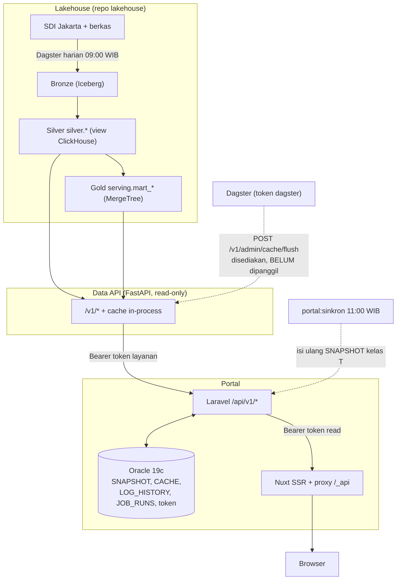
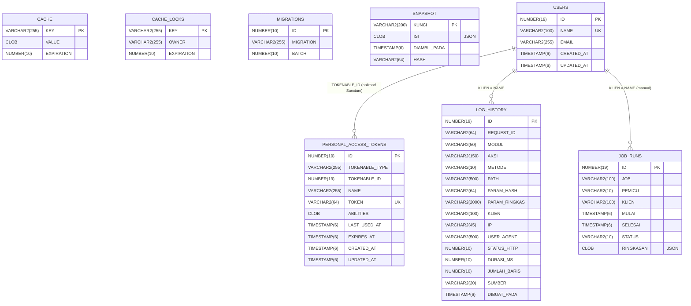

# Data diagram portal

SPEC §6 dan §8. Bagian di antara penanda `<!-- MULAI:… -->` dan `<!-- SELESAI:… -->` dihasilkan
`scripts/dokumen/bangun.py` (dijalankan oleh `scripts/ekspor-dokumen.sh`); jangan diedit tangan.

## 1. Alir data

Portal tidak menyimpan data pariwisata. Angka selalu berasal dari lakehouse lewat Data API; Oracle
hanya menyimpan data milik app (akun layanan, token, log, snapshot, cache).

| Lapis | Tempat | Isi |
|---|---|---|
| Bronze | Iceberg `lake.bronze_*` | apa adanya, semua kolom teks + kolom audit |
| Silver | ClickHouse `silver.*` | bertipe, dibersihkan; dibaca endpoint dataset |
| Gold | ClickHouse `serving.mart_*` | teragregasi; dibaca dashboard, indikator, atlas |
| Data API | `lakehouse/data-api` | satu-satunya pembaca ClickHouse untuk portal; envelope `{data, meta}` |
| Laravel | `port/backend` | meneruskan `data` tanpa diubah, menambah `meta.sumber/stale/request_id`; snapshot, cache, log |
| Nuxt | `port/frontend` | render; token tidak pernah ke browser |

Garis putus-putus = jalur terjadwal, bukan jalur request. Flush cache Data API sudah tersedia tetapi
per 2 Nov 2026 pipeline Dagster belum memanggilnya; cache Data API habis sendiri setelah TTL (300 s).

Kelas endpoint (SPEC §4.6): **T** tetap → `SNAPSHOT`, **P** berparameter → `CACHE` (TTL), **S** aliran
→ tidak disimpan. Alur rinci per fitur ada di `docs/flowchart/`.

## 2. ERD Oracle

Dibangkitkan dari `backend/database/oracle/portal-ddl.sql`, yaitu dump `DBMS_METADATA` atas skema hasil
migration (`scripts/oracle-dump.sh`). Skrip memeriksa bahwa daftar tabel dump sama dengan tabel yang
dibuat `backend/database/migrations/`.

<!-- MULAI:erd -->

Relasi di atas **logis**: skema tidak memakai FOREIGN KEY (log dan token tetap tersimpan
walau akun dihapus). Kolom `ID` diisi sequence + trigger `<TABEL>_ID_TRG` (default yajra).

#### CACHE

| Kolom | Tipe Oracle | Wajib | Kunci |
|---|---|---|---|
| `KEY` | VARCHAR2(255) | ya | PK |
| `VALUE` | CLOB | ya |  |
| `EXPIRATION` | NUMBER(10,0) | ya |  |

#### CACHE_LOCKS

| Kolom | Tipe Oracle | Wajib | Kunci |
|---|---|---|---|
| `KEY` | VARCHAR2(255) | ya | PK |
| `OWNER` | VARCHAR2(255) | ya |  |
| `EXPIRATION` | NUMBER(10,0) | ya |  |

#### JOB_RUNS

| Kolom | Tipe Oracle | Wajib | Kunci |
|---|---|---|---|
| `ID` | NUMBER(19,0) | ya | PK |
| `JOB` | VARCHAR2(100) | ya |  |
| `PEMICU` | VARCHAR2(10) | ya |  |
| `KLIEN` | VARCHAR2(100) |  |  |
| `MULAI` | TIMESTAMP(6) | ya |  |
| `SELESAI` | TIMESTAMP(6) |  |  |
| `STATUS` | VARCHAR2(10) | ya |  |
| `RINGKASAN` | CLOB |  | CHECK IS JSON |

Indeks: `JOB_RUNS_JOB_IDX (JOB, MULAI)`

#### LOG_HISTORY

| Kolom | Tipe Oracle | Wajib | Kunci |
|---|---|---|---|
| `ID` | NUMBER(19,0) | ya | PK |
| `REQUEST_ID` | VARCHAR2(64) | ya |  |
| `MODUL` | VARCHAR2(50) |  |  |
| `AKSI` | VARCHAR2(150) |  |  |
| `METODE` | VARCHAR2(10) | ya |  |
| `PATH` | VARCHAR2(500) | ya |  |
| `PARAM_HASH` | VARCHAR2(64) | ya |  |
| `PARAM_RINGKAS` | VARCHAR2(2000) |  |  |
| `KLIEN` | VARCHAR2(100) |  |  |
| `IP` | VARCHAR2(45) |  |  |
| `USER_AGENT` | VARCHAR2(500) |  |  |
| `STATUS_HTTP` | NUMBER(10,0) | ya |  |
| `DURASI_MS` | NUMBER(10,0) | ya |  |
| `JUMLAH_BARIS` | NUMBER(10,0) |  |  |
| `SUMBER` | VARCHAR2(20) |  |  |
| `DIBUAT_PADA` | TIMESTAMP(6) | ya |  |

Indeks: `LOG_HIST_MODUL_IDX (MODUL, DIBUAT_PADA)`; `LOG_HIST_RID_IDX (REQUEST_ID)`

#### MIGRATIONS

| Kolom | Tipe Oracle | Wajib | Kunci |
|---|---|---|---|
| `ID` | NUMBER(10,0) | ya | PK |
| `MIGRATION` | VARCHAR2(255) | ya |  |
| `BATCH` | NUMBER(10,0) | ya |  |

#### PERSONAL_ACCESS_TOKENS

| Kolom | Tipe Oracle | Wajib | Kunci |
|---|---|---|---|
| `ID` | NUMBER(19,0) | ya | PK |
| `TOKENABLE_TYPE` | VARCHAR2(255) | ya |  |
| `TOKENABLE_ID` | NUMBER(19,0) | ya |  |
| `NAME` | VARCHAR2(255) | ya |  |
| `TOKEN` | VARCHAR2(64) | ya | UK |
| `ABILITIES` | CLOB |  |  |
| `LAST_USED_AT` | TIMESTAMP(6) |  |  |
| `EXPIRES_AT` | TIMESTAMP(6) |  |  |
| `CREATED_AT` | TIMESTAMP(6) |  |  |
| `UPDATED_AT` | TIMESTAMP(6) |  |  |

Indeks: `PAT_TOKENABLE_IDX (TOKENABLE_TYPE, TOKENABLE_ID)`

#### SNAPSHOT

| Kolom | Tipe Oracle | Wajib | Kunci |
|---|---|---|---|
| `KUNCI` | VARCHAR2(200) | ya | PK |
| `ISI` | CLOB | ya | CHECK IS JSON |
| `DIAMBIL_PADA` | TIMESTAMP(6) | ya |  |
| `HASH` | VARCHAR2(64) | ya |  |

#### USERS

| Kolom | Tipe Oracle | Wajib | Kunci |
|---|---|---|---|
| `ID` | NUMBER(19,0) | ya | PK |
| `NAME` | VARCHAR2(100) | ya | UK |
| `EMAIL` | VARCHAR2(255) |  |  |
| `CREATED_AT` | TIMESTAMP(6) |  |  |
| `UPDATED_AT` | TIMESTAMP(6) |  |  |
<!-- SELESAI:erd -->

## 3. Kamus data per endpoint

Dibangkitkan dari kontrak Data API (`docs/api/data-api.openapi.yaml`, salinan
`lakehouse/data-api/openapi.yaml`): field `data` respons sukses, tipe, keterangan, dan tabel lake yang
dibaca (`x-sumber`). Laravel meneruskan `data` byte-identik, jadi field-nya sama untuk path Laravel
yang tercantum. Semua respons sukses juga membawa `meta` (`request_id`, `sumber`, `stale`, dan meta
Data API seperti `source`, `total`).

**Celah: arti per field belum didokumentasikan.** Kolom *Arti* hanya diisi dari `description` di
kontrak (Data API atau ekspor Scramble Laravel); tidak ada yang dikarang. Saat ini kontrak belum
memuat `description` per field, jadi hampir semua *Arti* bertanda "—". Tempat melengkapinya adalah
`lakehouse/data-api/openapi.yaml` (sumber kebenaran kontrak); setelah disalin ulang
(`scripts/salin-openapi.sh`), kamus ini terisi otomatis. Kolom *Contoh* diambil dari contoh respons
di kontrak yang sama.

<!-- MULAI:kamus -->
### `GET /v1/katalog`

- Laravel: `GET /api/v1/katalog`
- Kelas: T
- Sumber lake: `lake.bronze_meta.dataset_catalog`, `lake.bronze_meta_sec.dataset_catalog`, `lake.bronze_meta*.dataset_sync`
- Ringkas: Katalog dataset primer (lake) + sekunder + medallion

| Field | Tipe | Arti | Contoh |
|---|---|---|---|
| `data` | object | — |  |
| `data.items` | array<object> | — |  |
| `data.items[].id` | string | — | `"sdi-data-jumlah-wisatawan-mancanegar…` |
| `data.items[].title` | string | — | `"Data Jumlah Wisatawan Mancanegara Be…` |
| `data.items[].description` | string | — | `"Data ini berisikan data kunjungan wi…` |
| `data.items[].tags` | array<string> | — |  |
| `data.items[].tier` | string | — | `"primer"` |
| `data.items[].sumber` | sdi \| internal \| instansi \| crawling | — | `"sdi"` |
| `data.items[].source` | string | — | `"SDI · Satu Data Jakarta"` |
| `data.items[].size_label` | string | — | `"1.598 dilihat"` |
| `data.items[].href` | string | — | `"/sdi/data-jumlah-wisatawan-mancanega…` |
| `data.items[].external` | boolean | — | `false` |
| `data.items[].kosong` | boolean | Dataset primer yang terdaftar di Satu Data Jakarta tetapi belum berisi baris di sana (sekunder selalu false). | `false` |
| `data.items[].medallion` | null \| object | — |  |
| `data.stats` | object | — |  |
| `data.stats.total` | integer | — | `184` |
| `data.stats.tags` | integer | — | `264` |
| `data.stats.views` | integer | — | `68553` |
| `data.stats.last_updated` | string | — | `"2026-10-21T03:19:38.000000Z"` |
| `data.layer_counts` | object | — |  |

### `GET /v1/dataset/{slug}`

- Laravel: `GET /api/v1/dataset/{slug}`
- Kelas: P
- Sumber lake: `lake.bronze_meta*.dataset_catalog`, `lake.bronze_meta*.dataset_sync`, `silver.<tabel>`
- Ringkas: Metadata satu dataset

| Field | Tipe | Arti | Contoh |
|---|---|---|---|
| `data` | object | — |  |
| `data.slug` | string | — | `"data-event-pariwisata-dan-kebudayaan…` |
| `data.title` | string | — | `"Data Event Pariwisata dan Kebudayaan…` |
| `data.description` | string | — | `"Data ini Berisi Mengenai Data Event …` |
| `data.sumber_data` | array<string> | — |  |
| `data.frekuensi` | null \| string | — | `"1 Tahun Sekali"` |
| `data.satuan` | null \| string | — |  |
| `data.periode` | null \| object | — |  |
| `data.klasifikasi` | null | — |  |
| `data.kontak` | null \| string | — | `"info@jakarta-tourism.go.id"` |
| `data.author` | string | — | `"User Dinas Pariwisata Dan Ekonomi Kr…` |
| `data.medallion` | object | — |  |
| `data.medallion.level` | string | — | `"gold"` |
| `data.medallion.table` | string | — | `"data_event_pariwisata_dan_kebudayaan…` |
| `data.medallion.mart` | string | — | `"mart_event"` |
| `data.total_bronze` | integer | — | `1391` |

### `GET /v1/dataset/{slug}/kolom`

- Laravel: `GET /api/v1/dataset/{slug}/kolom`
- Kelas: P
- Sumber lake: `lake.bronze_meta*.dataset_column`, `silver.<tabel>`
- Ringkas: Kolom tampil dataset (metadata + periode_data Silver)

| Field | Tipe | Arti | Contoh |
|---|---|---|---|
| `data` | object | — |  |
| `data.items` | array<object> | — |  |
| `data.items[].key` | string | — | `"periode_data"` |
| `data.items[].desc` | null \| string | — |  |
| `data.items[].type` | null \| string | — |  |

### `GET /v1/dataset/{slug}/facet`

- Laravel: `GET /api/v1/dataset/{slug}/facet`
- Kelas: P
- Sumber lake: `silver.<tabel>`
- Ringkas: Pilihan filter per kolom (seluruh dataset)

| Field | Tipe | Arti | Contoh |
|---|---|---|---|
| `data` | object | — |  |
| `data.items` | array<object> | — |  |
| `data.items[].key` | string | — | `"periode_data"` |
| `data.items[].kind` | string | — | `"angka"` |
| `data.items[].min` | string | — | `"2011"` |
| `data.items[].max` | string | — | `"2019"` |
| `data.items[].values` | array<object> | — |  |
| `data.items[].values[].v` | string | — |  |
| `data.items[].values[].n` | integer | — |  |

### `GET /v1/dataset/{slug}/baris`

- Laravel: `GET /api/v1/dataset/{slug}/baris`
- Kelas: P
- Sumber lake: `silver.<tabel>`
- Ringkas: Baris Silver berhalaman dengan cari, filter, urut

| Field | Tipe | Arti | Contoh |
|---|---|---|---|
| `data` | object | — |  |
| `data.items` | array<object> | — |  |

### `GET /v1/dataset/{slug}/agregat`

- Laravel: `GET /api/v1/dataset/{slug}/agregat`
- Kelas: P
- Sumber lake: `silver.<tabel>`
- Ringkas: Agregasi grafik atas seluruh baris hasil filter

| Field | Tipe | Arti | Contoh |
|---|---|---|---|
| `data` | object | — |  |
| `data.items` | array<object> | — |  |
| `data.items[].name` | string | — | `"MALAYSIA"` |
| `data.items[].value` | integer | — | `31` |

### `GET /v1/dataset/{slug}/ekspor`

- Laravel: `GET /api/v1/dataset/{slug}/ekspor`
- Kelas: S
- Sumber lake: `silver.<tabel>`
- Ringkas: Unduh baris hasil filter/urut sebagai CSV atau XLSX

Respons berkas/aliran (text/csv, application/vnd.openxmlformats-officedocument.spreadsheetml.sheet); tidak ada field JSON.

### `GET /v1/dashboard/ringkasan`

- Laravel: `GET /api/v1/dashboard/ringkasan`
- Kelas: T
- Sumber lake: `serving.mart_wisman`, `lake.bronze_file.target_wisman`, `lake.bronze_file.pdrb_ekraf_makro`, `lake.bronze_file.target_kontribusi_ekraf_rpjmd`
- Ringkas: KPI beranda dashboard

| Field | Tipe | Arti | Contoh |
|---|---|---|---|
| `data` | object | — |  |
| `data.wisman` | object | — |  |
| `data.wisman.tahun` | string | — | `"2025"` |
| `data.wisman.jumlah` | integer \| null | — | `2754220` |
| `data.wisman.target` | integer | — | `1286092` |
| `data.pdrb` | object | — |  |
| `data.pdrb.tahun` | string | — | `"2024"` |
| `data.pdrb.kontribusi_pct` | number | — | `11.16` |
| `data.pdrb.target_tahun` | string | — | `"2025"` |
| `data.pdrb.target_pct` | number | — | `10.51` |
| `data.pdrb.adhb_ekraf_miliar` | number | — | `410568.43` |
| `data.pdrb.tumbuh_ekraf_pct` | number | — | `8.13` |
| `data.pdrb.tumbuh_dki_pct` | number | — | `4.91` |
| `data.kpi` | array<object> | — |  |
| `data.kpi[].label` | string | — | `"Wisman 2025"` |
| `data.kpi[].value` | integer \| string | — | `2754220` |
| `data.kpi[].sub` | string | — | `"target RPJMD 1.286.092"` |

### `GET /v1/dashboard/wisman/tahunan`

- Laravel: `GET /api/v1/dashboard/wisman/tahunan`
- Kelas: T
- Sumber lake: `serving.mart_wisman`, `lake.bronze_file.target_wisman`
- Ringkas: Capaian wisman per tahun vs target RPJMD

| Field | Tipe | Arti | Contoh |
|---|---|---|---|
| `data` | object | — |  |
| `data.data_tersedia` | object | — |  |
| `data.data_tersedia.dari` | string \| null | — | `"2024-01"` |
| `data.data_tersedia.sampai` | string \| null | — | `"2026-07"` |
| `data.tahun` | array<object> | — |  |
| `data.tahun[].tahun` | string | — | `"2024"` |
| `data.tahun[].label` | string | — | `"2024"` |
| `data.tahun[].jumlah` | integer | — | `2526842` |
| `data.tahun[].target` | integer \| null | — |  |
| `data.pertumbuhan` | object | — |  |
| `data.pertumbuhan.label` | string | — | `"Pertumbuhan 2025"` |
| `data.pertumbuhan.persen` | number \| null | — | `8.998504853093307` |
| `data.pertumbuhan.sub` | string \| null | — | `"vs 2024"` |
| `data.tahun_default` | string \| null | — | `"2025"` |
| `data.kpi` | array<object> | — |  |
| `data.kpi[].label` | string | — | `"Capaian 2024"` |
| `data.kpi[].value` | integer \| string | — | `2526842` |
| `data.kpi[].sub` | string | — | `"target RPJMD belum ditetapkan"` |
| `data.kpi[].delta` | number | — |  |

### `GET /v1/dashboard/wisman/bulanan`

- Laravel: `GET /api/v1/dashboard/wisman/bulanan`
- Kelas: T
- Sumber lake: `serving.mart_wisman`, `silver.data_rata_rata_lama_menginap_wisatawan_mancanegara_dan_wisatawan_nusantara_pada_hotel_berbintang_di_provinsi_dki_jakarta`
- Ringkas: Deret bulanan, YoY, dan KPI bulan terpilih

| Field | Tipe | Arti | Contoh |
|---|---|---|---|
| `data` | object | — |  |
| `data.rows` | array<object> | — |  |
| `data.rows[].periode` | string | — | `"2024-01"` |
| `data.rows[].jumlah` | integer | — | `186773` |
| `data.yoy` | object | — |  |
| `data.yoy.kategori` | array<string> | — |  |
| `data.yoy.seri` | array<object> | — |  |
| `data.yoy.seri[].name` | string | — | `"2024"` |
| `data.yoy.seri[].data` | array<object> | — |  |
| `data.yoy.seri[].data[].label` | string | — | `"Jan"` |
| `data.yoy.seri[].data[].value` | integer | — | `186773` |
| `data.pertumbuhan` | array<object> | — |  |
| `data.pertumbuhan[].periode` | string | — | `"2025-01"` |
| `data.pertumbuhan[].persen` | number | — | `3.6` |
| `data.periode` | string | — | `"2026-07"` |
| `data.kpi` | array<object> | — |  |
| `data.kpi[].label` | string | — | `"Wisman Jul 2026"` |
| `data.kpi[].value` | integer \| string | — | `307247` |
| `data.kpi[].sub` | string | — | `"kunjungan"` |
| `data.kpi[].delta` | null \| number | — |  |

### `GET /v1/dashboard/wisman/kebangsaan`

- Laravel: `GET /api/v1/dashboard/wisman/kebangsaan`
- Kelas: P
- Sumber lake: `serving.mart_wisman`
- Ringkas: Top negara + Lainnya untuk satu tahun atau bulan

| Field | Tipe | Arti | Contoh |
|---|---|---|---|
| `data` | object | — |  |
| `data.periode` | string | — | `"2024-01"` |
| `data.label` | string | — | `"Jan 2024"` |
| `data.items` | array<object> | — |  |
| `data.items[].label` | string | — | `"Tiongkok"` |
| `data.items[].value` | integer | — | `27396` |

### `GET /v1/dashboard/wisman/pintu-masuk`

- Laravel: `GET /api/v1/dashboard/wisman/pintu-masuk`
- Kelas: P
- Sumber lake: `serving.mart_wisman`, `silver.jumlah_wisatawan`, `silver.wisman_per_pintu_masuk_bulanan_bps`
- Ringkas: Wisman per pintu masuk (semester SDI atau bulanan BPS)

| Field | Tipe | Arti | Contoh |
|---|---|---|---|
| `data` | object | — |  |
| `data.sumber` | string | — | `"bps_bulanan"` |
| `data.label` | string | — | `"Jan 2024"` |
| `data.semester` | null \| string | — |  |
| `data.items` | array<object> | — |  |
| `data.items[].label` | string | — | `"Soekarno-Hatta"` |
| `data.items[].value` | integer | — | `157979` |

### `GET /v1/dashboard/lama-menginap/rata-rata`

- Laravel: `GET /api/v1/dashboard/lama-menginap/rata-rata`
- Kelas: T
- Sumber lake: `silver.data_rata_rata_lama_menginap_wisatawan_mancanegara_dan_wisatawan_nusantara_pada_hotel_berbintang_di_provinsi_dki_jakarta`
- Ringkas: Rata-rata lama menginap lintas kelas per bulan

| Field | Tipe | Arti | Contoh |
|---|---|---|---|
| `data` | object | — |  |
| `data.wisman` | array<object> | — |  |
| `data.wisman[].periode` | string | — | `"2023-11"` |
| `data.wisman[].nilai` | number | — | `2.52` |
| `data.wisnus` | array<object> | — |  |
| `data.wisnus[].periode` | string | — | `"2023-11"` |
| `data.wisnus[].nilai` | number | — | `1.57` |

### `GET /v1/dashboard/lama-menginap/per-kelas`

- Laravel: `GET /api/v1/dashboard/lama-menginap/per-kelas`
- Kelas: P
- Sumber lake: `silver.data_rata_rata_lama_menginap_wisatawan_mancanegara_dan_wisatawan_nusantara_pada_hotel_berbintang_di_provinsi_dki_jakarta`
- Ringkas: Lama menginap per kelas hotel vs bulan yang sama tahun lalu

| Field | Tipe | Arti | Contoh |
|---|---|---|---|
| `data` | object | — |  |
| `data.periode_list` | array<string> | — |  |
| `data.periode` | string | — | `"2023-11"` |
| `data.label` | string | — | `"Nov 2023"` |
| `data.tabel` | object | — |  |
| `data.tabel.header` | array<string> | — |  |
| `data.tabel.rows` | array<array<string>> | — |  |

### `GET /v1/dashboard/lama-menginap/seri`

- Laravel: `GET /api/v1/dashboard/lama-menginap/seri`
- Kelas: T
- Sumber lake: `silver.data_rata_rata_lama_menginap_wisatawan_mancanegara_dan_wisatawan_nusantara_pada_hotel_berbintang_di_provinsi_dki_jakarta`
- Ringkas: Deret lama menginap per kelas hotel

| Field | Tipe | Arti | Contoh |
|---|---|---|---|
| `data` | object | — |  |
| `data.seri` | array<object> | — |  |
| `data.seri[].name` | string | — | `"Bintang 1"` |
| `data.seri[].data` | array<object> | — |  |
| `data.seri[].data[].label` | string | — | `"2023-11"` |
| `data.seri[].data[].value` | number | — | `1.32` |

### `GET /v1/dashboard/wisnus/meta`

- Laravel: `GET /api/v1/dashboard/wisnus/meta`
- Kelas: T
- Sumber lake: `silver.wisnus_perjalanan_per_kota_tujuan`
- Ringkas: Opsi kota, tahun, tahun hilang, tahun default

| Field | Tipe | Arti | Contoh |
|---|---|---|---|
| `data` | object | — |  |
| `data.kota` | array<string> | — |  |
| `data.tahun` | array<string> | — |  |
| `data.tahun_hilang_teks` | null | — |  |
| `data.tahun_default` | string \| null | — | `"2025"` |

### `GET /v1/dashboard/wisnus/tahunan`

- Laravel: `GET /api/v1/dashboard/wisnus/tahunan`
- Kelas: P
- Sumber lake: `silver.wisnus_perjalanan_per_kota_tujuan`
- Ringkas: Capaian wisnus per tahun + KPI

| Field | Tipe | Arti | Contoh |
|---|---|---|---|
| `data` | object | — |  |
| `data.tahun` | array<object> | — |  |
| `data.tahun[].label` | string | — | `"2019"` |
| `data.tahun[].value` | integer | — | `11900934` |
| `data.kpi` | array<object> | — |  |
| `data.kpi[].label` | string | — | `"Capaian 2025"` |
| `data.kpi[].value` | integer \| string | — | `16532290` |
| `data.kpi[].sub` | string | — | `"perjalanan"` |
| `data.kpi[].delta` | number | — |  |

### `GET /v1/dashboard/wisnus/per-kota`

- Laravel: `GET /api/v1/dashboard/wisnus/per-kota`
- Kelas: P
- Sumber lake: `silver.wisnus_perjalanan_per_kota_tujuan`
- Ringkas: Perjalanan per kota tujuan untuk satu tahun

| Field | Tipe | Arti | Contoh |
|---|---|---|---|
| `data` | object | — |  |
| `data.label` | string | — | `"2019"` |
| `data.items` | array<object> | — |  |
| `data.items[].label` | string | — | `"Jakarta Pusat"` |
| `data.items[].value` | integer | — | `13740806` |

### `GET /v1/dashboard/wisnus/bulanan`

- Laravel: `GET /api/v1/dashboard/wisnus/bulanan`
- Kelas: P
- Sumber lake: `silver.wisnus_perjalanan_per_kota_tujuan`
- Ringkas: Deret bulanan per kota tujuan

| Field | Tipe | Arti | Contoh |
|---|---|---|---|
| `data` | object | — |  |
| `data.seri` | array<object> | — |  |
| `data.seri[].name` | string | — | `"Jakarta Barat"` |
| `data.seri[].data` | array<object> | — |  |
| `data.seri[].data[].label` | string | — | `"2019-01"` |
| `data.seri[].data[].value` | integer | — | `1044844` |

### `GET /v1/dashboard/wisnus/yoy`

- Laravel: `GET /api/v1/dashboard/wisnus/yoy`
- Kelas: P
- Sumber lake: `silver.wisnus_perjalanan_per_kota_tujuan`
- Ringkas: YoY bulanan wisnus (3 tahun terakhir) + pertumbuhan

| Field | Tipe | Arti | Contoh |
|---|---|---|---|
| `data` | object | — |  |
| `data.kategori` | array<string> | — |  |
| `data.seri` | array<object> | — |  |
| `data.seri[].name` | string | — | `"2024"` |
| `data.seri[].data` | array<object> | — |  |
| `data.seri[].data[].label` | string | — | `"Jan"` |
| `data.seri[].data[].value` | integer | — | `1066025` |
| `data.pertumbuhan` | array<object> | — |  |
| `data.pertumbuhan[].periode` | string | — | `"2020-01"` |
| `data.pertumbuhan[].persen` | number | — | `-20.1` |

### `GET /v1/dashboard/destinasi/meta`

- Laravel: `GET /api/v1/dashboard/destinasi/meta`
- Kelas: T
- Sumber lake: `silver.jumlah_kunjungan_wisatawan_ke_obyek_wisata_menurut_lokasi_di_provinsi_dki_jakarta`
- Ringkas: Pilihan tahun dan destinasi kunjungan obyek wisata

| Field | Tipe | Arti | Contoh |
|---|---|---|---|
| `data` | object | — |  |
| `data.tahun` | array<object> | — |  |
| `data.tahun[].value` | string | — | `"2025"` |
| `data.tahun[].label` | string | — | `"2025"` |
| `data.tahun_default` | string \| null | — | `"2025"` |
| `data.destinasi` | array<string> | — |  |

### `GET /v1/dashboard/destinasi/ringkasan`

- Laravel: `GET /api/v1/dashboard/destinasi/ringkasan`
- Kelas: P
- Sumber lake: `silver.jumlah_kunjungan_wisatawan_ke_obyek_wisata_menurut_lokasi_di_provinsi_dki_jakarta`
- Ringkas: KPI dan catatan kunjungan obyek wisata

| Field | Tipe | Arti | Contoh |
|---|---|---|---|
| `data` | object | — |  |
| `data.kpi` | array<object> | — |  |
| `data.kpi[].label` | string | — | `"Kunjungan wisatawan mancanegara · 2025"` |
| `data.kpi[].value` | integer \| number \| string | — | `636235` |
| `data.kpi[].sub` | string \| null | — | `"kunjungan"` |
| `data.catatan` | array<string> | — |  |

### `GET /v1/dashboard/destinasi/per-destinasi`

- Laravel: `GET /api/v1/dashboard/destinasi/per-destinasi`
- Kelas: P
- Sumber lake: `silver.jumlah_kunjungan_wisatawan_ke_obyek_wisata_menurut_lokasi_di_provinsi_dki_jakarta`
- Ringkas: Kunjungan per destinasi untuk satu tahun

| Field | Tipe | Arti | Contoh |
|---|---|---|---|
| `data` | object | — |  |
| `data.label` | string | — | `"2025"` |
| `data.items` | array<object> | — |  |
| `data.items[].destinasi` | string | — | `"Monumen Nasional"` |
| `data.items[].jumlah` | integer \| number | — | `426241` |
| `data.items[].persen` | number \| null | — | `67` |
| `data.items[].bulan` | integer | — | `12` |

### `GET /v1/dashboard/destinasi/bulanan`

- Laravel: `GET /api/v1/dashboard/destinasi/bulanan`
- Kelas: P
- Sumber lake: `silver.jumlah_kunjungan_wisatawan_ke_obyek_wisata_menurut_lokasi_di_provinsi_dki_jakarta`
- Ringkas: Kunjungan bulanan semua destinasi atau satu destinasi

| Field | Tipe | Arti | Contoh |
|---|---|---|---|
| `data` | object | — |  |
| `data.items` | array<object> | — |  |
| `data.items[].label` | string | — | `"2025-01"` |
| `data.items[].value` | integer \| number | — | `738` |

### `GET /v1/dashboard/tenaga-kerja/dki`

- Laravel: `GET /api/v1/dashboard/tenaga-kerja/dki`
- Kelas: T
- Sumber lake: `silver.tenaga_kerja_ekraf_per_provinsi`
- Ringkas: Tenaga kerja ekraf DKI per tahun + KPI

| Field | Tipe | Arti | Contoh |
|---|---|---|---|
| `data` | object | — |  |
| `data.rows` | array<object> | — |  |
| `data.rows[].tahun` | string | — | `"2020"` |
| `data.rows[].total` | integer | — | `998923` |
| `data.rows[].porsi_pct` | number | — | `5.15` |
| `data.rows[].laki` | integer | — | `494896` |
| `data.rows[].perempuan` | integer | — | `504027` |
| `data.kpi` | array<object> | — |  |
| `data.kpi[].label` | string | — | `"Tenaga kerja ekraf DKI 2024"` |
| `data.kpi[].value` | integer \| string | — | `1257285` |
| `data.kpi[].sub` | string | — | `"orang"` |
| `data.kpi[].delta` | number | — |  |

### `GET /v1/dashboard/tenaga-kerja/subsektor`

- Laravel: `GET /api/v1/dashboard/tenaga-kerja/subsektor`
- Kelas: P
- Sumber lake: `silver.tenaga_kerja_ekraf_per_subsektor_nasional`
- Ringkas: Tenaga kerja ekraf nasional per subsektor

| Field | Tipe | Arti | Contoh |
|---|---|---|---|
| `data` | object | — |  |
| `data.tahun_list` | array<string> | — |  |
| `data.tahun` | string | — | `"2020"` |
| `data.items` | array<object> | — |  |
| `data.items[].label` | string | — | `"Kuliner"` |
| `data.items[].value` | integer | — | `10670832` |

### `GET /v1/dashboard/tenaga-kerja/sertifikasi`

- Laravel: `GET /api/v1/dashboard/tenaga-kerja/sertifikasi`
- Kelas: T
- Sumber lake: `silver.jumlah_tenaga_kerja_pariwisata_dan_ekonomi_kreatif_yang_tersertifikasi`, `silver.jumlah_tenaga_kerja_pariwisata_dan_ekonomi_kreatif_yang_tersertifikasi_tahun_2023_dan_2024`
- Ringkas: Peserta sertifikasi per tahun dan per bidang

| Field | Tipe | Arti | Contoh |
|---|---|---|---|
| `data` | object | — |  |
| `data.per_tahun` | array<object> | — |  |
| `data.per_tahun[].label` | string | — | `"2023"` |
| `data.per_tahun[].value` | integer | — | `800` |
| `data.bidang` | array<string> | — |  |
| `data.seri` | array<object> | — |  |
| `data.seri[].name` | string | — | `"2023"` |
| `data.seri[].data` | array<object> | — |  |
| `data.seri[].data[].label` | string | — | `"Kepemanduan"` |
| `data.seri[].data[].value` | integer | — | `100` |

### `GET /v1/dashboard/pdrb-ekraf/makro`

- Laravel: `GET /api/v1/dashboard/pdrb-ekraf/makro`
- Kelas: T
- Sumber lake: `lake.bronze_file.pdrb_ekraf_makro`, `lake.bronze_file.target_kontribusi_ekraf_rpjmd`
- Ringkas: PDRB ekraf makro + kontribusi vs target (13 baris)

| Field | Tipe | Arti | Contoh |
|---|---|---|---|
| `data` | object | — |  |
| `data.sumber` | string | — | `"PDRB Ekonomi Kreatif DKI Jakarta 201…` |
| `data.rows` | array<object> | — |  |
| `data.rows[].periode` | string | — | `"2017"` |
| `data.rows[].label` | string | — | `"2017"` |
| `data.rows[].adhb_ekraf` | number | — | `231873.77` |
| `data.rows[].adhb_dki` | number | — | `2365353.85` |
| `data.rows[].kontribusi_pct` | number | — | `9.8` |
| `data.rows[].adhk_ekraf` | number | — | `181166.87` |
| `data.rows[].tumbuh_ekraf_pct` | number | — | `8.28` |
| `data.rows[].tumbuh_non_ekraf_pct` | number | — | `5.94` |
| `data.rows[].tumbuh_dki_pct` | number | — | `6.2` |
| `data.kontribusi_vs_target` | array<object> | — |  |
| `data.kontribusi_vs_target[].label` | string | — | `"2017"` |
| `data.kontribusi_vs_target[].capaian` | null \| number | — | `9.8` |
| `data.kontribusi_vs_target[].target` | null \| number | — |  |
| `data.target_kontribusi` | array<object> | — |  |
| `data.target_kontribusi[].tahun` | string | — | `"2025"` |
| `data.target_kontribusi[].target_pct` | number | — | `10.51` |

### `GET /v1/dashboard/pdrb-ekraf/subsektor/sebaran`

- Laravel: `GET /api/v1/dashboard/pdrb-ekraf/subsektor/sebaran`
- Kelas: P
- Sumber lake: `lake.bronze_file.pdrb_ekraf_subsektor`
- Ringkas: Distribusi subsektor (5 terbesar + Lainnya) dan 10 nilai terbesar

| Field | Tipe | Arti | Contoh |
|---|---|---|---|
| `data` | object | — |  |
| `data.periode_list` | array<string> | — |  |
| `data.periode` | string | — | `"2024"` |
| `data.label` | string | — | `"2024"` |
| `data.distribusi` | array<object> | — |  |
| `data.distribusi[].label` | string | — | `"Kuliner"` |
| `data.distribusi[].nama` | string | — | `"Kuliner"` |
| `data.distribusi[].pct` | number | — | `38.94` |
| `data.nilai_top10` | array<object> | — |  |
| `data.nilai_top10[].label` | string | — | `"Kuliner"` |
| `data.nilai_top10[].value` | number | — | `159870.42` |

### `GET /v1/dashboard/pdrb-ekraf/subsektor/pertumbuhan`

- Laravel: `GET /api/v1/dashboard/pdrb-ekraf/subsektor/pertumbuhan`
- Kelas: P
- Sumber lake: `lake.bronze_file.pdrb_ekraf_subsektor`
- Ringkas: Pertumbuhan per subsektor

| Field | Tipe | Arti | Contoh |
|---|---|---|---|
| `data` | object | — |  |
| `data.periode_list` | array<string> | — |  |
| `data.periode` | string | — | `"2024"` |
| `data.label` | string | — | `"2024"` |
| `data.items` | array<object> | — |  |
| `data.items[].label` | string | — | `"Kuliner"` |
| `data.items[].value` | number | — | `9.25` |

### `GET /v1/indikator`

- Laravel: `GET /api/v1/indikator`
- Kelas: T
- Sumber lake: `lake.bronze_file.gci_gpci_indicators`, `lake.bronze_meta*.dataset_catalog`, `silver.*`
- Ringkas: Daftar indikator satu framework + status readiness

| Field | Tipe | Arti | Contoh |
|---|---|---|---|
| `data` | object | — |  |
| `data.framework` | string | — | `"GPCI"` |
| `data.summary` | array<object> | — |  |
| `data.summary[].label` | string | — | `"TOTAL INDIKATOR"` |
| `data.summary[].value` | string | — | `"20"` |
| `data.rows` | array<object> | — |  |
| `data.rows[].no` | integer \| null | — | `22` |
| `data.rows[].code` | string | — | `"CI-IC"` |
| `data.rows[].framework` | string | — | `"GPCI"` |
| `data.rows[].dimension` | string | — | `"Cultural Interaction"` |
| `data.rows[].group` | string | — | `"Volume of Interaction"` |
| `data.rows[].name` | string | — | `"Jumlah konferensi internasional"` |
| `data.rows[].status` | string | — | `"partial"` |
| `data.rows[].data_available` | boolean | — | `true` |
| `data.rows[].owner` | string | — | `"DISPAREKRAF"` |
| `data.rows[].note` | string | — | `"Tersedia data Usaha MICE berizin; ju…` |
| `data.rows[].datasets` | array<object> | — |  |
| `data.rows[].datasets[].slug` | string | — | `"jumlah-usaha-penyelenggaraan-pertemu…` |
| `data.rows[].datasets[].title` | string | — | `"Jumlah Usaha Penyelenggaraan Pertemu…` |
| `data.rows[].datasets[].total` | integer | — | `8636` |
| `data.rows[].latest` | null \| object | — |  |
| `data.gaps` | array<string> | — |  |

### `GET /v1/indikator/{code}`

- Laravel: `GET /api/v1/indikator/{code}`
- Kelas: T
- Sumber lake: `lake.bronze_file.gci_gpci_indicators`, `lake.bronze_meta*.dataset_catalog`, `silver.*`, `lake.bronze_file.gci_gpci_benchmark`
- Ringkas: Detail satu indikator: sumber, KPI, blok

| Field | Tipe | Arti | Contoh |
|---|---|---|---|
| `data` | object | — |  |
| `data.code` | string | — | `"CE1"` |
| `data.indikator` | object | Identitas indikator untuk hero halaman (nama, definisi, dimensi). |  |
| `data.indikator.framework` | string | — |  |
| `data.indikator.dimension` | string \| null | — |  |
| `data.indikator.name` | string | — |  |
| `data.indikator.definition` | string \| null | — |  |
| `data.indikator.owner` | string \| null | — |  |
| `data.indikator.note` | string \| null | — |  |
| `data.konteks` | null \| object | Benchmark indeks (kartu IndexContext), dari `gci_gpci_benchmark`; null bila tidak ada. |  |
| `data.sources` | array<object> | — |  |
| `data.sources[].slug` | string | — | `"data-kunjungan-wisatawan-nusantara-d…` |
| `data.sources[].title` | string | — | `"Data Kunjungan Wisatawan Nusantara d…` |
| `data.sources[].tier` | string | — | `"primer"` |
| `data.source_text` | null \| string | — |  |
| `data.kpis` | array<object> | — |  |
| `data.kpis[].label` | string | — | `"Total kunjungan"` |
| `data.kpis[].value` | number \| string | — | `34812` |
| `data.kpis[].sub` | null \| string | — |  |
| `data.blocks` | array<object> | — |  |
| `data.blocks[].type` | string | — | `"line"` |
| `data.blocks[].title` | string | — | `"Tren kunjungan per periode"` |
| `data.blocks[].layout` | string | — | `"full"` |
| `data.blocks[].data` | array<object> \| object | — |  |
| `data.teks_fallback` | null \| array<string> | — |  |

### `GET /v1/gci/resmi`

- Laravel: `GET /api/v1/gci/resmi`
- Kelas: T
- Sumber lake: `lake.bronze_file.gci_kearney_resmi`
- Ringkas: Peringkat Kearney + 4 kartu indikator pariwisata

| Field | Tipe | Arti | Contoh |
|---|---|---|---|
| `data` | object | — |  |
| `data.ranking` | object | — |  |
| `data.ranking.cultural` | object | — |  |
| `data.ranking.cultural.y2024` | integer | — | `52` |
| `data.ranking.cultural.y2025` | integer | — | `58` |
| `data.ranking.overall` | object | — |  |
| `data.ranking.overall.y2024` | integer | — | `74` |
| `data.ranking.overall.y2025` | integer | — | `71` |
| `data.ranking.sumber` | object | — |  |
| `data.ranking.sumber.label` | string | — | `"jakarta.go.id/competitiveness"` |
| `data.ranking.sumber.url` | string | — | `"https://www.jakarta.go.id/competitiv…` |
| `data.ranking.catatan` | string | — | `"Kearney GCI 2025. Peringkat makin ke…` |
| `data.kartu` | array<object> | — |  |
| `data.kartu[].label` | string | — | `"Jumlah Museum"` |
| `data.kartu[].nilai` | string | — | `"79"` |
| `data.kartu[].satuan` | string | — | `"Museum"` |
| `data.kartu[].tahun` | string | — | `"2025"` |
| `data.kartu[].sumber` | string | — | `"satudata.jakarta.go.id"` |
| `data.kartu[].catatan` | null \| string | — |  |
| `data.kartu[].href` | null \| string | — |  |

### `GET /v1/dataset-tematik`

- Laravel: `GET /api/v1/dataset-tematik`
- Kelas: T
- Sumber lake: `shared/hitungan.py (tabel sumber atlas + katalog sekunder)`
- Ringkas: Kartu dataset GCI/GPCI beserta jumlah baris

| Field | Tipe | Arti | Contoh |
|---|---|---|---|
| `data` | object | — |  |
| `data.items` | array<object> | — |  |
| `data.items[].no` | string | — | `"05"` |
| `data.items[].title` | string | — | `"Lapangan Golf"` |
| `data.items[].href` | string | — | `"/gpci/lapangan-golf"` |
| `data.items[].total` | integer | — | `14` |

### `GET /v1/pariwisata/wisatawan-internasional`

- Laravel: `GET /api/v1/pariwisata/wisatawan-internasional`
- Kelas: T
- Sumber lake: `silver.wisman_jakarta_per_bulan`, `silver.wisman_jakarta_per_negara`, `silver.wisman_jakarta_per_pintu_masuk`, `lake.bronze_file.target_wisman`, `lake.bronze_file.gci_kearney_resmi`
- Ringkas: Halaman wisatawan internasional

| Field | Tipe | Arti | Contoh |
|---|---|---|---|
| `data` | object | — |  |
| `data.shell` | object | — |  |
| `data.kpis` | array<object> | — |  |
| `data.kpis[].label` | string | — | `"Total wisman 2025"` |
| `data.kpis[].value` | integer \| string | — | `2754220` |
| `data.kpis[].sub` | string | — | `"akumulasi bulanan"` |
| `data.kpis[].delta` | number | — |  |
| `data.kartu` | array<object> | — |  |
| `data.kartu[].judul` | string | — | `"Tren bulanan 2025"` |
| `data.kartu[].sub` | string | — | `"kunjungan per bulan (batang)"` |
| `data.kartu[].komponen` | string | — | `"VerticalBars"` |
| `data.kartu[].data` | object | — |  |
| `data.kartu[].data.data` | array<object> | — |  |
| `data.kartu[].data.data[].label` | string | — | `"2025-01-01"` |
| `data.kartu[].data.data[].value` | integer | — | `193528` |
| `data.kartu[].data.series` | array<object> | — |  |
| `data.kartu[].data.series[].name` | string | — |  |
| `data.kartu[].data.series[].data` | array<object> | — |  |
| `data.kartu[].data.series[].data[].label` | string | — |  |
| `data.kartu[].data.series[].data[].value` | integer | — |  |
| `data.kartu[].data.categories` | array<string> | — |  |
| `data.raw` | array<object> | — |  |
| `data.raw[].slug` | string | — | `"wisman-jakarta-per-bulan"` |
| `data.raw[].title` | string | — | `"Wisman per bulan (2024–2026)"` |
| `data.raw[].count` | integer | — | `28` |
| `data.komponen` | object | — |  |
| `data.tabel` | array<object> | — |  |
| `data.tabel[].header` | array<string> | — |  |
| `data.tabel[].rows` | array<array<string>> | — |  |

### `GET /v1/pariwisata/kuliner-michelin`

- Laravel: `GET /api/v1/pariwisata/kuliner-michelin`
- Kelas: T
- Sumber lake: `silver.jumlah_restoran_per_kelurahan`, `silver.data_usaha_jasa_makanan_dan_minuman_jenis_usaha_restoran_di_dki_jakarta`, `silver.restoran_tripadvisor_jakarta`, `lake.bronze_file.gci_kearney_resmi`
- Ringkas: Halaman kuliner (Michelin)

| Field | Tipe | Arti | Contoh |
|---|---|---|---|
| `data` | object | — |  |
| `data.shell` | object | — |  |
| `data.kpis` | array<object> | — |  |
| `data.kpis[].label` | string | — | `"Restoran Michelin"` |
| `data.kpis[].value` | integer \| string | — | `"0"` |
| `data.kpis[].sub` | null \| string | — | `"Michelin Guide · 2025"` |
| `data.kartu` | array<object> | — |  |
| `data.kartu[].judul` | string | — | `"Restoran per wilayah"` |
| `data.kartu[].sub` | string \| null | — | `"2026"` |
| `data.kartu[].komponen` | string | — | `"BarBreakdown"` |
| `data.kartu[].data` | object | — |  |
| `data.kartu[].data.data` | array<object> | — |  |
| `data.kartu[].data.data[].label` | string | — | `"Jakarta Selatan"` |
| `data.kartu[].data.data[].value` | integer | — | `5276` |
| `data.raw` | array<object> | — |  |
| `data.raw[].slug` | string | — | `"jumlah-restoran-per-kelurahan"` |
| `data.raw[].title` | string | — | `"Jumlah restoran per kelurahan (2026)"` |
| `data.raw[].count` | integer | — | `517` |
| `data.komponen` | object | — |  |
| `data.tabel` | array<object> | — |  |
| `data.tabel[].header` | array<string> | — |  |
| `data.tabel[].rows` | array<array<string>> | — |  |

### `GET /v1/pariwisata/seni-pertunjukan`

- Laravel: `GET /api/v1/pariwisata/seni-pertunjukan`
- Kelas: P
- Sumber lake: `silver.data_seni_pertunjukan_dan_visual`, `silver.jumlah_penyelenggaraan_event`, `silver.artis_top_global_chart`, `silver.data_penyelenggaraan_event_pariwisata_dan_budaya_dki_jakarta`, `silver.data_event_pariwisata_dan_kebudayaan_dki_jakarta_2011_2019`, `silver.data_rekomendasi_penyelenggaraan_pertunjukan_musik`, `lake.bronze_file.seni_venue`, `lake.bronze_file.artis_tampil_jakarta`, `lake.bronze_file.gci_kearney_resmi`
- Ringkas: Halaman seni pertunjukan

| Field | Tipe | Arti | Contoh |
|---|---|---|---|
| `data` | object | — |  |
| `data.shell` | object | — |  |
| `data.kpis` | array<object> | — |  |
| `data.kpis[].label` | string | — | `"Jumlah pertunjukan"` |
| `data.kpis[].value` | integer \| string | — | `352` |
| `data.kpis[].sub` | null \| string | — | `"semua tahun"` |
| `data.kartu` | array<object> | — |  |
| `data.kartu[].judul` | string | — | `"Penyelenggaraan event / bulan"` |
| `data.kartu[].sub` | null \| string | — | `"semua event pariwisata & budaya · 20…` |
| `data.kartu[].komponen` | string | — | `"LineTrend"` |
| `data.kartu[].data` | object | — |  |
| `data.kartu[].data.data` | array<object> | — |  |
| `data.kartu[].data.data[].label` | string | — | `"202401"` |
| `data.kartu[].data.data[].value` | integer | — | `57` |
| `data.raw` | array<object> | — |  |
| `data.raw[].slug` | string | — | `"data-seni-pertunjukan-dan-visual"` |
| `data.raw[].title` | string | — | `"Seni Visual & Pertunjukan"` |
| `data.raw[].count` | integer | — | `352` |
| `data.komponen` | object | — |  |
| `data.tabel` | array<object> | — |  |
| `data.tabel[].header` | array<string> | — |  |
| `data.tabel[].rows` | array<array<string>> | — |  |
| `data.tabel[].tautan` | array<string \| null> | URL verifikasi per baris tabel artis yang tampil di Jakarta (null = data event Dispar). |  |

### `GET /v1/atlas/restoran-gci`

- Laravel: `GET /api/v1/atlas/restoran-gci`
- Kelas: T
- Sumber lake: `lake.bronze_file.gci_venue_kurasi`, `lake.bronze_file.gci_venue_osm`, `lake.bronze_file.gci_venue_rating`, `lake.bronze_file.gci_venue_alamat`, `lake.bronze_file.gci_venue_harga`, `lake.bronze_file.gci_resto_hotel`
- Ringkas: Restoran GCI (merge kurasi + OSM, dedup ≤ 60 m)

| Field | Tipe | Arti | Contoh |
|---|---|---|---|
| `data` | object | — |  |
| `data.items` | array<object> | — |  |
| `data.items[].id` | string | — | `"osm-w-370539428"` |
| `data.items[].name` | string | — | `"Canary Coffee Shop"` |
| `data.items[].cuisine` | string | — | `"Restoran Hotel"` |
| `data.items[].area` | string | — |  |
| `data.items[].address` | null \| string | — |  |
| `data.items[].address_display` | string | — |  |
| `data.items[].city` | string | — |  |
| `data.items[].hotel` | null \| string | — |  |
| `data.items[].tier` | string | — |  |
| `data.items[].source` | string | — |  |
| `data.items[].lat` | null \| number | — |  |
| `data.items[].lng` | null \| number | — |  |
| `data.items[].rating` | null \| number | — |  |
| `data.items[].review_count` | integer \| null | — |  |
| `data.items[].rating_source` | null \| string | — |  |
| `data.items[].place_id` | null \| string | — |  |
| `data.items[].price_level` | null \| string | — |  |
| `data.items[].price_source` | null \| string | — |  |
| `data.items[].needs_verify` | boolean | — |  |
| `data.items[].maps_url` | string | — |  |
| `data.stats` | object | — |  |
| `data.stats.total` | integer | — | `2577` |
| `data.stats.rated` | integer | — | `1793` |
| `data.stats.hotel` | integer | — | `138` |
| `data.stats.cafe` | integer | — | `712` |
| `data.stats.restoran` | integer | — | `1727` |
| `data.curated` | integer | — | `65` |
| `data.tiers` | array<string> | — |  |
| `data.cities` | array<string> | — |  |

### `GET /v1/atlas/direktori-restoran`

- Laravel: `GET /api/v1/atlas/direktori-restoran`
- Kelas: T
- Sumber lake: `lake.bronze_file.restoran_kurasi`, `lake.bronze_file.restoran_osm`
- Ringkas: Direktori restoran (kurasi + OSM, filter DKI)

| Field | Tipe | Arti | Contoh |
|---|---|---|---|
| `data` | object | — |  |
| `data.items` | array<object> | — |  |
| `data.items[].id` | string | — | `"toscana"` |
| `data.items[].name` | string | — | `"Toscana"` |
| `data.items[].cuisine` | string | — | `"Italian"` |
| `data.items[].category` | string | — |  |
| `data.items[].area` | string | — |  |
| `data.items[].city` | string | — |  |
| `data.items[].address` | null \| string | — |  |
| `data.items[].price_range` | null \| string | — |  |
| `data.items[].price_note` | null \| string | — |  |
| `data.items[].rating` | null \| number | — |  |
| `data.items[].review_count` | integer \| null | — |  |
| `data.items[].rating_source` | null \| string | — |  |
| `data.items[].highlights` | array<string> | — |  |
| `data.items[].description` | null \| string | — |  |
| `data.items[].sources` | array<object> | — |  |
| `data.items[].sources[].label` | string | — |  |
| `data.items[].sources[].url` | string | — |  |
| `data.items[].source` | string | — |  |
| `data.items[].lat` | null \| number | — |  |
| `data.items[].lng` | null \| number | — |  |
| `data.items[].osm_id` | null \| string | — |  |
| `data.items[].phone` | null \| string | — |  |
| `data.items[].website` | null \| string | — |  |
| `data.items[].maps_url` | string | — |  |
| `data.items[].embed_url` | string | — |  |
| `data.stats` | object | — |  |
| `data.stats.total` | integer | — | `604` |
| `data.stats.cuisines` | integer | — | `103` |
| `data.stats.rated` | integer | — | `141` |
| `data.stats.avg_rating` | number | — | `4.559574468085108` |
| `data.cities` | array<string> | — |  |
| `data.cuisines` | array<string> | — |  |

### `GET /v1/atlas/pertunjukan`

- Laravel: `GET /api/v1/atlas/pertunjukan`
- Kelas: T
- Sumber lake: `lake.bronze_file.event_pertunjukan`
- Ringkas: Pertunjukan & budaya 2025–2026

| Field | Tipe | Arti | Contoh |
|---|---|---|---|
| `data` | object | — |  |
| `data.items` | array<object> | — |  |
| `data.items[].id` | string | — | `"n02"` |
| `data.items[].organizer` | string | — | `"Expoindo"` |
| `data.items[].name` | string | — | `"Pasar Malam Empat Satoe Slank (HUT k…` |
| `data.items[].date` | string | — | `"2025-01-04"` |
| `data.items[].date_sort` | integer | — | `20250104` |
| `data.items[].venue` | string | — | `"JIExpo Kemayoran, Jakarta"` |
| `data.items[].type` | string | — | `"Konser Musik Nasional (Rock/Pop)"` |
| `data.items[].visitors` | string | — | `""` |
| `data.items[].visitors_needs_verify` | boolean | — | `false` |
| `data.items[].note` | string | — | `"Konser tunggal HUT ke-41 Slank"` |
| `data.items[].category` | string | — | `"Konser Musik"` |
| `data.items[].source` | string | — | `"https://exhibition.jiexpo.com/slank-…` |
| `data.stats` | object | — |  |
| `data.stats.total` | integer | — | `308` |
| `data.stats.konser` | integer | — | `125` |
| `data.stats.festival` | integer | — | `24` |
| `data.stats.budaya` | integer | — | `159` |
| `data.categories` | array<string> | — |  |

### `GET /v1/atlas/golf`

- Laravel: `GET /api/v1/atlas/golf`
- Kelas: T
- Sumber lake: `lake.bronze_file.golf`
- Ringkas: Lapangan golf

| Field | Tipe | Arti | Contoh |
|---|---|---|---|
| `data` | object | — |  |
| `data.items` | array<object> | — |  |
| `data.items[].id` | string | — | `"jakarta-golf-club"` |
| `data.items[].name` | string | — | `"Jakarta Golf Club"` |
| `data.items[].kind` | string | — | `"Course"` |
| `data.items[].holes` | integer \| null | — |  |
| `data.items[].par` | integer \| null | — |  |
| `data.items[].designer` | null \| string | — |  |
| `data.items[].established` | integer \| null | — |  |
| `data.items[].membership` | string | — |  |
| `data.items[].city` | string | — |  |
| `data.items[].area` | string | — |  |
| `data.items[].address` | null \| string | — |  |
| `data.items[].lat` | number | — |  |
| `data.items[].lng` | number | — |  |
| `data.items[].website` | null \| string | — |  |
| `data.items[].description` | string | — |  |
| `data.items[].highlights` | array<string> | — |  |
| `data.items[].sources` | array<object> | — |  |
| `data.items[].sources[].label` | string | — |  |
| `data.items[].sources[].url` | string | — |  |
| `data.items[].maps_url` | string | — |  |
| `data.stats` | object | — |  |
| `data.stats.total` | integer | — | `14` |
| `data.stats.courses` | integer | — | `9` |
| `data.stats.ranges` | integer | — | `5` |
| `data.stats.total_holes` | integer | — | `171` |

### `GET /v1/atlas/suvenir`

- Laravel: `GET /api/v1/atlas/suvenir`
- Kelas: T
- Sumber lake: `lake.bronze_file.souvenir`
- Ringkas: Toko suvenir

| Field | Tipe | Arti | Contoh |
|---|---|---|---|
| `data` | object | — |  |
| `data.items` | array<object> | — |  |
| `data.items[].id` | string | — | `"flea-market-at-jalan-surabaya"` |
| `data.items[].name` | string | — | `"Flea Market at Jalan Surabaya"` |
| `data.items[].category` | string | — | `"Pasar Loak & Pasar Jalanan"` |
| `data.items[].relevance` | string | — |  |
| `data.items[].product` | null \| string | — |  |
| `data.items[].address` | string | — |  |
| `data.items[].city` | string | — |  |
| `data.items[].district` | string | — |  |
| `data.items[].lat` | null \| number | — |  |
| `data.items[].lng` | null \| number | — |  |
| `data.items[].coord_source` | null \| string | — |  |
| `data.items[].phone` | null \| string | — |  |
| `data.items[].rating` | null \| number | — |  |
| `data.items[].reviews` | integer \| null | — |  |
| `data.items[].status` | string | — |  |
| `data.items[].note` | string | — |  |
| `data.items[].url` | string | — |  |
| `data.items[].maps_url` | string | — |  |
| `data.items[].embed_url` | string | — |  |
| `data.stats` | object | — |  |
| `data.stats.total` | integer | — | `67` |
| `data.stats.ya` | integer | — | `23` |
| `data.stats.sebagian` | integer | — | `12` |
| `data.stats.tidak` | integer | — | `30` |
| `data.stats.belum_pasti` | integer | — | `2` |
| `data.stats.avg_rating` | number | — | `4.185106382978724` |
| `data.stats.geo` | integer | — | `61` |
| `data.products` | array<string> | — |  |
| `data.cities` | array<string> | — |  |

### `GET /v1/atlas/hotel`

- Laravel: `GET /api/v1/atlas/hotel`
- Kelas: T
- Sumber lake: `lake.bronze_file.hotel_registri`, `lake.bronze_file.hotel_tpk`, `lake.bronze_file.hotel_los`
- Ringkas: Hotel & akomodasi (registri, TPK, lama menginap)

| Field | Tipe | Arti | Contoh |
|---|---|---|---|
| `data` | object | — |  |
| `data.built` | string | — | `"2026-09-09"` |
| `data.registry_period` | string | — | `"202301–202311"` |
| `data.sources` | array<string> | — |  |
| `data.kpi` | object | — |  |
| `data.kpi.hotels` | integer | — | `120` |
| `data.kpi.rooms` | integer | — | `24049` |
| `data.kpi.occupancy_latest` | number | — | `53.53599999999999` |
| `data.kpi.occupancy_period` | string | — | `"202605"` |
| `data.kpi.los_latest` | number | — | `1.8419999999999999` |
| `data.kpi.los_period` | string | — | `"202605"` |
| `data.tpk_chart` | object | — |  |
| `data.tpk_chart.periods` | array<string> | — |  |
| `data.tpk_chart.series` | array<object> | — |  |
| `data.tpk_chart.series[].name` | string | — | `"Bintang 1"` |
| `data.tpk_chart.series[].data` | array<number> | — |  |
| `data.los_chart` | object | — |  |
| `data.los_chart.periods` | array<string> | — |  |
| `data.los_chart.series` | array<object> | — |  |
| `data.los_chart.series[].name` | string | — | `"Wisman"` |
| `data.los_chart.series[].data` | array<number> | — |  |
| `data.registry` | array<object> | — |  |
| `data.registry[].nama` | string | — | `"SHANGRI-LA JAKARTA"` |
| `data.registry[].jenis_usaha` | string | — | `"HOTEL"` |
| `data.registry[].golongan` | string | — | `"BINTANG 5"` |
| `data.registry[].kamar` | integer | — | `662` |
| `data.registry[].alamat` | string | — | `"KOTA BNI, JL. JEND. SUDIRMAN KAV. 1,…` |
| `data.registry[].wilayah` | string | — | `"JAKARTA PUSAT"` |
| `data.registry[].periode` | string | — | `"202311"` |
| `data.filters` | object | — |  |
| `data.filters.wilayah` | array<string> | — |  |
| `data.filters.golongan` | array<string> | — |  |

### `GET /v1/gmti/ringkasan`

- Laravel: `GET /api/v1/gmti/ringkasan`
- Kelas: T
- Sumber lake: `lake.bronze_file.gmti_tempat`, `lake.bronze_file.gmti_kecamatan`, `lake.bronze_file.gmti_tipologi`, `lake.bronze_file.gmti_capaian`, `lake.bronze_file.gmti_ibadah`
- Ringkas: Ringkasan GMTI (meta, pilar, kecamatan, tipologi, capaian)

| Field | Tipe | Arti | Contoh |
|---|---|---|---|
| `data` | object | — |  |
| `data.meta` | object | — |  |
| `data.meta.source` | string | — | `"SIMAS Kemenag RI — Sistem Informasi …` |
| `data.meta.source_url` | string | — | `"https://simas.kemenag.go.id/page/pro…` |
| `data.meta.fetched_at` | string | — | `"2026-08-31T13:42:12.938Z"` |
| `data.meta.ibadah_total` | integer | — |  |
| `data.meta.masjid` | integer | — |  |
| `data.meta.mushalla` | integer | — |  |
| `data.meta.ibadah_non_signature` | integer | — |  |
| `data.meta.ibadah_signature` | integer | — |  |
| `data.meta.ibadah_berkoordinat` | integer | — |  |
| `data.meta.halal_total` | integer | — |  |
| `data.meta.halal_berkoordinat` | integer | — |  |
| `data.meta.kecamatan` | integer | — |  |
| `data.meta.kecamatan_tanpa_poligon` | array<string> | — |  |
| `data.meta.tanpa_kecamatan` | integer | — |  |
| `data.pillars` | array<object> | — |  |
| `data.pillars[].id` | string | — | `"ibadah"` |
| `data.pillars[].label` | string | — | `"Ibadah"` |
| `data.pillars[].desc` | string | — | `"Masjid & mushalla terdaftar SIMAS Ke…` |
| `data.pillars[].color` | string | — | `"#0f7b6c"` |
| `data.kecamatan` | array<object> | — |  |
| `data.kecamatan[].kecamatan` | string | — | `"Tanjung Priok"` |
| `data.kecamatan[].kota` | string | — | `"Kota Administrasi Jakarta Utara"` |
| `data.kecamatan[].geo_key` | string | — | `"tanjungpriok"` |
| `data.kecamatan[].masjid` | integer | — | `177` |
| `data.kecamatan[].mushalla` | integer | — | `331` |
| `data.kecamatan[].total` | integer | — | `508` |
| `data.tipologi` | array<object> | — |  |
| `data.tipologi[].tipologi` | string | — | `"Masjid Jami"` |
| `data.tipologi[].jenis` | string | — | `"masjid"` |
| `data.tipologi[].count` | integer | — | `3712` |
| `data.capaian` | array<object> | — |  |
| `data.capaian[].nama` | string | — | `"GMTI 2019 — Peringkat 1 Destinasi Wi…` |
| `data.capaian[].pemberi` | string | — | `"Mastercard & CrescentRating (Global …` |
| `data.capaian[].tahun` | null \| string | — | `"2019"` |
| `data.capaian[].tingkat` | string | — | `"internasional"` |
| `data.capaian[].deskripsi` | string | — | `"Indonesia berbagi posisi teratas den…` |
| `data.award` | object | — |  |
| `data.award.nama` | string | — | `"GMTI 2019 — Peringkat 1 Destinasi Wi…` |
| `data.award.pemberi` | string | — | `"Mastercard & CrescentRating (Global …` |
| `data.award.tahun` | string | — | `"2019"` |
| `data.award.tingkat` | string | — | `"internasional"` |
| `data.award.deskripsi` | string | — | `"Indonesia berbagi posisi teratas den…` |

### `GET /v1/gmti/tempat`

- Laravel: `GET /api/v1/gmti/tempat`
- Kelas: P
- Sumber lake: `lake.bronze_file.gmti_tempat`, `lake.bronze_file.gmti_kecamatan`, `lake.bronze_file.gmti_tipologi`, `lake.bronze_file.gmti_capaian`, `lake.bronze_file.gmti_ibadah`
- Ringkas: Daftar fasilitas GMTI berhalaman + facet

| Field | Tipe | Arti | Contoh |
|---|---|---|---|
| `data` | object | — |  |
| `data.items` | array<object> | — |  |
| `data.items[].id` | string | — | `"simas-19"` |
| `data.items[].name` | string | — | `"ISTIQLAL"` |
| `data.items[].pillar` | string | — | `"ibadah"` |
| `data.items[].kind` | string | — |  |
| `data.items[].dataset` | string | — |  |
| `data.items[].href` | null \| string | — |  |
| `data.items[].address` | null \| string | — |  |
| `data.items[].city` | string | — |  |
| `data.items[].district` | null \| string | — |  |
| `data.items[].lat` | null \| number | — |  |
| `data.items[].lon` | null \| number | — |  |
| `data.items[].cert` | null \| string | — |  |
| `data.items[].note` | null \| string | — |  |
| `data.items[].maps_url` | string | — |  |
| `data.facets` | object | — |  |
| `data.facets.kota` | array<string> | — |  |
| `data.facets.jenis` | array<string> | — |  |

### `GET /v1/spasial`

- Laravel: `GET /api/v1/spasial`
- Kelas: T
- Sumber lake: `lake.bronze_file.* (atlas, seni_venue, gmti)`, `silver.<tabel berkoordinat>`, `serving.mart_hotel_scraped_booking`
- Ringkas: Semua titik peta + kepadatan per kecamatan

| Field | Tipe | Arti | Contoh |
|---|---|---|---|
| `data` | object | — |  |
| `data.points` | array<object> | — |  |
| `data.points[].id` | string | — | `"gci-osm-w-370539428"` |
| `data.points[].name` | string | — | `"Canary Coffee Shop"` |
| `data.points[].category` | string | — | `"gci"` |
| `data.points[].city` | string | — | `"Jakarta Selatan"` |
| `data.points[].address` | string | — | `"Jl. TB Simatupang No.Kav. 9, RT.2/RW…` |
| `data.points[].lat` | number | — | `-6.30135` |
| `data.points[].lng` | number | — | `106.834854` |
| `data.points[].href` | string | — | `"/gci/pariwisata/restoran-gci"` |
| `data.points[].kind` | null \| string | — |  |
| `data.points[].source` | null \| string | — |  |
| `data.cities` | array<string> | — |  |
| `data.di_luar_dki` | integer | Jumlah titik berkoordinat di luar DKI Jakarta (daratan + Kepulauan Seribu) yang tidak ditampilkan di peta. | `0` |
| `data.kepadatan_berkoordinat` | object | — |  |
| `data.inventory` | array<object> | — |  |
| `data.inventory[].slug` | string | — | `"jumlah-kunjungan-wisatawan-ke-obyek-…` |
| `data.inventory[].coordinates` | integer | — | `28` |
| `data.failed` | array<objek bebas> | — |  |
| `data.complete` | boolean | — | `true` |
| `data.kepadatan_tanpa_koordinat` | object | Fasilitas ibadah SIMAS tanpa koordinat per geo_key kecamatan (`ibadahNoCoord` GmtiMapView). |  |
| `data.catatan` | string | — | `"kepadatan_berkoordinat = titik berko…` |

### `GET /v1/spasial/titik/{id}`

- Laravel: `GET /api/v1/spasial/titik/{id}`
- Kelas: P
- Sumber lake: `sama dengan /v1/spasial`
- Ringkas: Detail satu titik untuk popup

| Field | Tipe | Arti | Contoh |
|---|---|---|---|
| `data` | object | — |  |
| `data.id` | string \| null | — | `"gci-osm-w-370539428"` |
| `data.name` | string \| null | — | `"Canary Coffee Shop"` |
| `data.category` | string \| null | — | `"gci"` |
| `data.city` | string \| null | — | `"Jakarta Selatan"` |
| `data.address` | string \| null | — | `"Jl. TB Simatupang No.Kav. 9, RT.2/RW…` |
| `data.lat` | number \| null | — | `-6.30135` |
| `data.lng` | number \| null | — | `106.834854` |
| `data.href` | string \| null | — | `"/gci/pariwisata/restoran-gci"` |
| `data.kind` | string \| null | — |  |
| `data.cert` | string \| null | — |  |
| `data.source` | string \| null | — |  |

### `GET /v1/hotel-scraped`

- Laravel: `GET /api/v1/hotel-scraped`
- Kelas: T
- Sumber lake: `lake.bronze_file.booking_hotel_2026_09_15`
- Ringkas: Snapshot hotel Booking.com (POC)

| Field | Tipe | Arti | Contoh |
|---|---|---|---|
| `data` | object | — |  |
| `data.rows` | array<object> | — |  |
| `data.rows[].hotel_id` | string \| null | — | `"the-orient-jakarta"` |
| `data.rows[].hotel_name` | string \| null | — | `"The Orient Jakarta, a Royal Hideaway…` |
| `data.rows[].hotel_url` | string \| null | — | `"https://www.booking.com/hotel/id/the…` |
| `data.rows[].address` | string \| null | — | `""` |
| `data.rows[].city` | string \| null | — | `"Jakarta"` |
| `data.rows[].country` | string \| null | — | `"Indonesia"` |
| `data.rows[].latitude` | number \| null | — |  |
| `data.rows[].longitude` | number \| null | — |  |
| `data.rows[].distance_km` | number \| null | — |  |
| `data.rows[].star_rating` | integer \| null | — |  |
| `data.rows[].review_score` | number \| null | — | `9.3` |
| `data.rows[].review_label` | string \| null | — | `"Superb"` |
| `data.rows[].review_count` | integer \| null | — | `1100` |
| `data.rows[].price_idr` | integer \| null | — | `2102265` |
| `data.rows[].price_currency` | string \| null | — | `"IDR"` |
| `data.rows[].price_raw` | string \| null | — | `"Rp 2,102,265"` |
| `data.rows[].rooms_left` | integer \| null | — |  |
| `data.rows[].total_room_types` | integer \| null | — |  |
| `data.rows[].is_available` | integer \| null | — | `1` |
| `data.rows[].checkin` | string \| null | — | `"2026-09-29"` |
| `data.rows[].checkout` | string \| null | — | `"2026-09-30"` |
| `data.rows[].adults` | integer \| null | — | `2` |
| `data.rows[].scraped_at` | string \| null | — | `"2026-09-15 07:33:20"` |
| `data.rows[].source` | string \| null | — | `"booking.com-poc"` |
| `data.rows[].room_types_json` | string \| null | — |  |
| `data.rows[].room_types` | array<objek bebas> | — |  |
| `data.stats` | object | — |  |
| `data.stats.total` | integer \| null | — | `72` |
| `data.stats.with_coords` | integer \| null | — | `54` |
| `data.stats.with_address` | integer \| null | — | `50` |
| `data.stats.with_rooms_left` | integer \| null | — | `0` |
| `data.stats.with_rooms` | integer \| null | — | `36` |
| `data.stats.avg_price` | integer \| null | — | `1229127` |
| `data.stats.min_price` | integer \| null | — | `209274` |
| `data.stats.max_price` | integer \| null | — | `4053500` |
| `data.stats.distinct_cities` | integer \| null | — | `1` |
| `data.stats.total_room_types` | integer \| null | — | `269` |
| `data.stats.avg_room_types_per_hotel` | number \| null | — | `14.2` |
| `data.price_histogram` | array<object> | — |  |
| `data.price_histogram[].bucket` | <500K \| 500K-1M \| 1M-2M \| 2M-5M \| 5M+ | — | `"<500K"` |
| `data.price_histogram[].count` | integer | — | `10` |
| `data.last_checkin` | string \| null | — | `"2026-09-29"` |
| `data.source` | string | — | `"booking.com-poc"` |
| `data.note` | string | — | `"Sandbox table from research-grade PO…` |

### `GET /v1/beranda/ringkasan`

- Laravel: `GET /api/v1/beranda/ringkasan`
- Kelas: T
- Sumber lake: `lake.bronze_meta*.dataset_catalog`, `lake.bronze_meta*.dataset_sync`, `lake.bronze_file.gci_gpci_indicators`
- Ringkas: Empat angka hero + stat kartu beranda

| Field | Tipe | Arti | Contoh |
|---|---|---|---|
| `data` | object | — |  |
| `data.dataset_primer` | integer | — | `184` |
| `data.dataset_sekunder` | integer | — | `44` |
| `data.baris_sekunder` | integer | Σ baris dataset sekunder (Data API menghitung dari Bronze; contoh = nilai katalog app 21 Okt 2026). | `19428` |
| `data.indikator` | object | — |  |
| `data.indikator.gci` | integer | — | `8` |
| `data.indikator.gpci` | integer | — | `20` |
| `data.indikator.total` | integer | — | `28` |
| `data.indeks_global` | integer | — | `2` |

### `GET /v1/health`

- Laravel: — (tidak dibuka lewat Laravel)
- Kelas: —
- Sumber lake: —
- Ringkas: Kesehatan Data API dan koneksi ClickHouse (tanpa token)

Skema `data` tidak dirinci di kontrak.

### `POST /v1/admin/cache/flush`

- Laravel: — (tidak dibuka lewat Laravel)
- Kelas: —
- Sumber lake: —
- Ringkas: Kosongkan cache in-process (dipanggil Dagster sesudah refresh_lakehouse)

| Field | Tipe | Arti | Contoh |
|---|---|---|---|
| `data` | object | — |  |
| `data.dikosongkan` | integer | — | `0` |

### Endpoint yang hanya ada di Laravel

Tidak punya padanan langsung di Data API (gabungan atau rute sistem):

- `GET /api/v1/dataset/{slug}/halaman` — Halaman pertama dataset
- `POST /api/v1/sistem/cache/kosongkan`
- `GET /api/v1/sistem/job`
- `POST /api/v1/sistem/job/sinkron`
- `GET /api/v1/sistem/kesehatan`
- `GET /api/v1/sistem/log`
<!-- SELESAI:kamus -->
