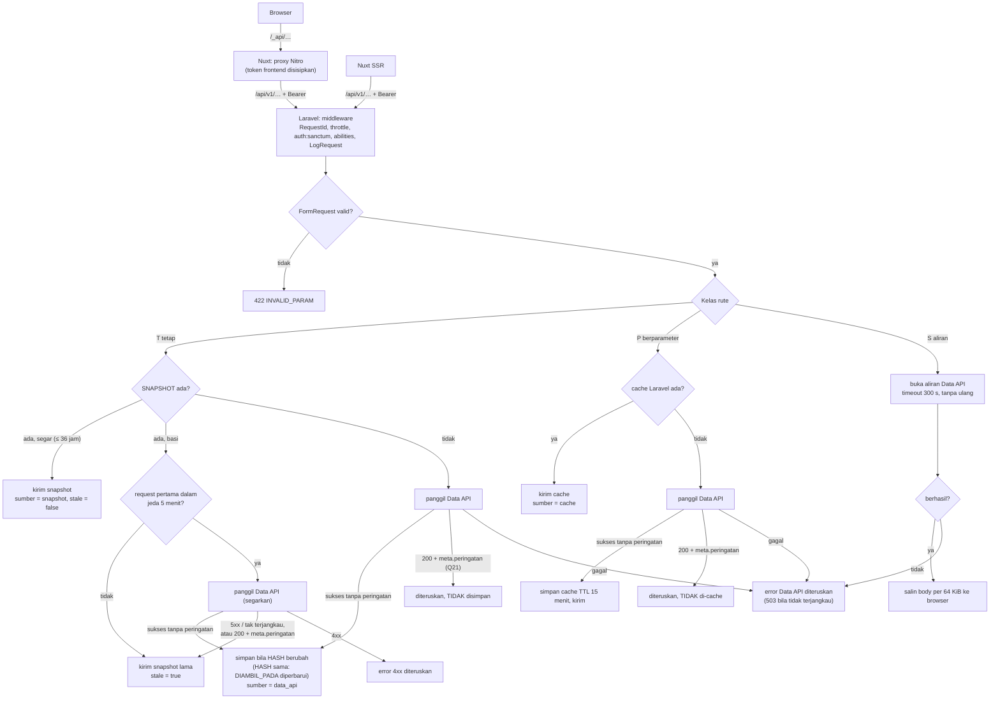

# Flowchart portal

Satu berkas per fitur (SPEC §4.2, KONTRAK §1–2), ditambah tiga alur lintas fitur. Setiap berkas
menyebut rute halaman Nuxt dan nama rute Laravel yang dicakupnya; `scripts/dokumen/bangun.py`
gagal bila ada rute di kode yang tidak disebut di salah satu berkas ini.

| Berkas | Isi |
|---|---|
| [beranda.md](beranda.md) | `/` dan `/docs` |
| [dataset.md](dataset.md) | katalog, SDI, detail dataset, ekspor |
| [dashboard.md](dashboard.md) | lima halaman dashboard |
| [indikator.md](indikator.md) | GCI/GPCI, detail indikator, tiga halaman pariwisata |
| [atlas.md](atlas.md) | enam subhalaman atlas |
| [gmti.md](gmti.md) | GMTI ringkasan dan daftar tempat |
| [spasial.md](spasial.md) | peta `/spatial` |
| [hotel-scraped.md](hotel-scraped.md) | `/scraped-hotels` |
| [autentikasi.md](autentikasi.md) | token, proxy Nuxt, kode error |
| [sinkron.md](sinkron.md) | job `portal:sinkron` dan rute admin sistem |
| [log-history.md](log-history.md) | `LOG_HISTORY`, `JOB_RUNS`, retensi |

## Pola bersama

Semua fitur memakai salah satu dari tiga jalur baca (SPEC §4.6). Kelas ditulis di rute
(`Route::apiGet(…, kelas: 'T'|'P'|'S')`).

Jalur T (`App\Shared\Tetap\BacaTetap`) dalam kalimat:

- Snapshot segar dikirim apa adanya. Snapshot dianggap **basi** bila lebih tua dari
  `PORTAL_SNAPSHOT_BASI_JAM` (36 jam).
- Snapshot basi **disegarkan saat dibaca**: satu request per kunci per `PORTAL_SEGARKAN_JEDA_MENIT`
  (5 menit) memanggil Data API. Request lain selama jeda itu, dan request yang penyegarannya gagal
  (5xx/tak terjangkau, atau jawaban berperingatan), langsung mendapat snapshot lama dengan
  `meta.stale = true`. Jadi saat Data API mati, pengunjung tidak menunggu timeout berulang kali.
  Ini juga menyegarkan kunci di luar daftar sinkron (mis. `periode` bebas di dashboard).
- Jawaban Data API 200 dengan `meta.peringatan` (Q21: query sumber gagal, data dikosongkan) tidak
  pernah disimpan di snapshot maupun cache.

Catatan umum:

- Klien Data API biasa: timeout 10 s per percobaan, diulang 2× hanya untuk 5xx dan gagal koneksi.
  Fitur yang komputasinya berat di Data API (atlas, gmti/spasial/hotel-scraped, indikator) memakai
  satu percobaan 60 s (`DATA_API_TIMEOUT_LAMBAT`).
- Gagal koneksi setelah semua percobaan → **503** `UPSTREAM_UNAVAILABLE`. Status 4xx/5xx Data API
  diteruskan dengan kodenya (`NOT_FOUND`, `INVALID_FILTER`, `TOO_LARGE`, …). 401/403 dari Data API
  berarti token layanan portal salah dan dijawab **502** `UPSTREAM_AUTH`.
- Error tidak pernah di-cache dan tidak pernah menimpa snapshot.
- Setiap request `/api/*` dicatat ke `LOG_HISTORY` setelah respons terkirim, kecuali rute di
  `loghistory.rute_dikecualikan` (`sistem.kesehatan`) ([log-history.md](log-history.md)).
