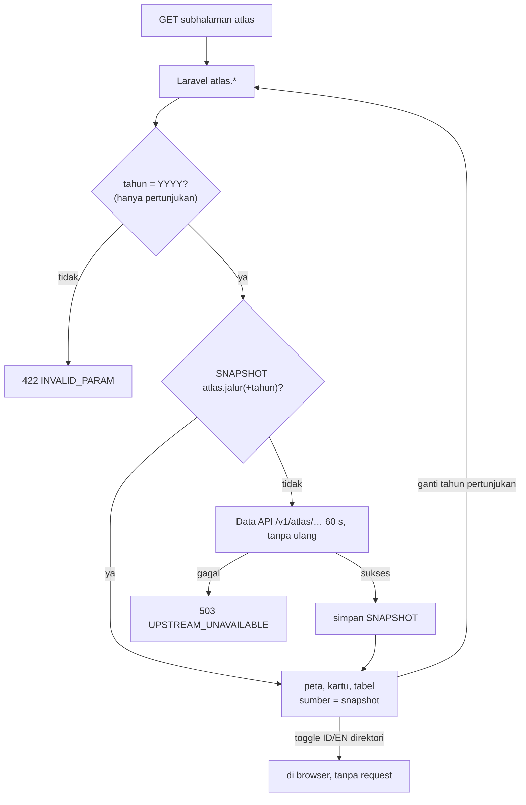

# Flowchart atlas

Layer Nuxt `atlas`, fitur Laravel `Features/Atlas`. Pola baca umum, termasuk penyegaran snapshot basi dan jawaban berperingatan: [README.md](README.md).

Rute halaman: `/gci/pariwisata/restoran-gci`, `/gci/pariwisata/direktori-restoran`,
`/gci/pariwisata/pertunjukan-budaya`, `/gpci/hotel`, `/gpci/lapangan-golf`, `/gpci/toko-suvenir`.
Redirect lama (`/atlas` → `/spatial`, `/atlas/:section`, `/katalog/hotel` → `/gpci/hotel`) dijawab
middleware Nitro `redirect-lama` sebelum halaman dirender.

| Rute API (nama) | Laravel `GET /api/v1/…` | Halaman | Kelas |
|---|---|---|---|
| `atlas.restoran-gci` | `atlas/restoran-gci` | `/gci/pariwisata/restoran-gci` | T |
| `atlas.direktori-restoran` | `atlas/direktori-restoran` | `/gci/pariwisata/direktori-restoran` | T |
| `atlas.pertunjukan` | `atlas/pertunjukan?tahun` | `/gci/pariwisata/pertunjukan-budaya` | T (varian tanpa tahun, 2025, 2026) |
| `atlas.hotel` | `atlas/hotel` | `/gpci/hotel` | T |
| `atlas.golf` | `atlas/golf` | `/gpci/lapangan-golf` | T |
| `atlas.suvenir` | `atlas/suvenir` | `/gpci/toko-suvenir` | T |

Semua rute memanggil Data API `/v1/atlas/<jalur>` dengan satu percobaan 60 s: gabungan dan dedup
restoran (± 2.577 baris) bisa melewati timeout biasa saat cache Data API dingin.

