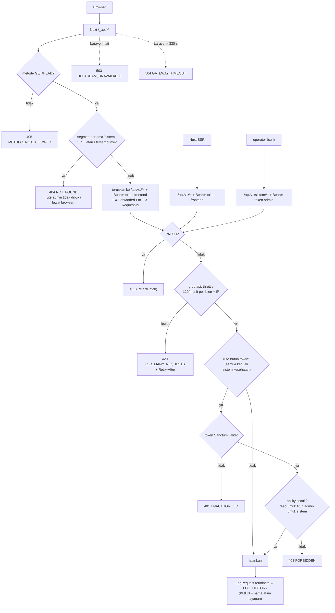

# Flowchart autentikasi

SPEC §4.4. Tidak ada login pengguna: yang memegang token adalah **akun layanan** (`USERS`), dibuat
`ServiceAccountSeeder`. Token Sanctum dibuat `php artisan portal:token {akun} {read|admin}` dan
hanya dicetak sekali (yang disimpan di `PERSONAL_ACCESS_TOKENS` adalah hash-nya).

| Pemegang | Ability | Dipakai untuk |
|---|---|---|
| server Nuxt (`NUXT_FRONTEND_TOKEN`) | `read` | semua rute fitur, lewat SSR dan proxy `/_api` |
| operator | `admin` | `sistem.log`, `sistem.job`, `sistem.job.sinkron`, `sistem.cache.kosongkan` |
| publik, tanpa token | — | `sistem.kesehatan` saja |

Token **tidak pernah** sampai ke browser: SSR memanggil Laravel langsung dari server, browser
memanggil proxy Nitro `/_api/**` yang menyisipkan token.

## Kode error

Semua error `/api/*` dalam envelope gagal `{success: false, message, errors: {code}, meta: {request_id}}`
(`App\Shared\Http\ExceptionRenderer`).

| HTTP | `errors.code` | Kapan |
|---|---|---|
| 401 | `UNAUTHORIZED` | token tidak ada atau tidak valid |
| 403 | `FORBIDDEN` | token tidak punya ability rute |
| 404 | `NOT_FOUND` | alamat tidak ada, atau Data API menjawab 404 (slug/kode/titik tak dikenal) |
| 405 | `METHOD_NOT_ALLOWED` | metode tidak diizinkan (termasuk semua PATCH) |
| 409 | `JOB_BERJALAN` | `sistem.job.sinkron` saat sinkron lain masih berjalan |
| 413 | `TOO_LARGE` | ekspor di atas batas baris Data API |
| 422 | `INVALID_PARAM` | parameter di luar kontrak; rincian di `errors.fields` |
| 429 | `TOO_MANY_REQUESTS` | batas laju terlampaui |
| 4xx lain | kode dari Data API | mis. 400 `INVALID_FILTER` |
| 502 | `UPSTREAM_AUTH` | token layanan Data API di server portal salah |
| 502 | `UPSTREAM_UNAVAILABLE` | Data API mengirim JSON yang tidak valid |
| 503 | `UPSTREAM_UNAVAILABLE` | Data API tidak terjangkau dan tidak ada snapshot |
| 500 | `INTERNAL` | kesalahan lain di server |
