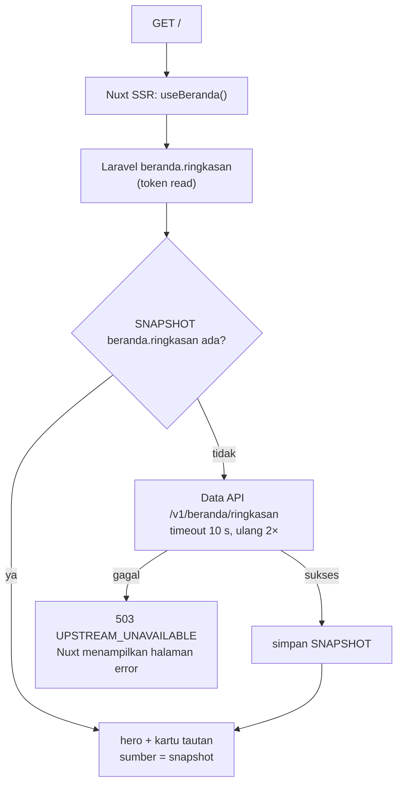
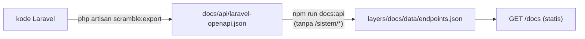

# Flowchart beranda dan /docs

Layer Nuxt `beranda` dan `docs`. Pola baca umum, termasuk penyegaran snapshot basi dan jawaban berperingatan: [README.md](README.md).

| Rute halaman | Rute API (nama) | Laravel | Data API | Kelas |
|---|---|---|---|---|
| `/` | `beranda.ringkasan` | `GET /api/v1/beranda/ringkasan` | `GET /v1/beranda/ringkasan` | T |
| `/docs` | — | — (isi statis dari `layers/docs/data/endpoints.json`) | — | — |

## Beranda `/`

## Dokumentasi API `/docs`

Halaman tidak memanggil API saat dibuka. Isinya `layers/docs/data/endpoints.json`, yang dibangkitkan
`npm run docs:api` dari ekspor Scramble `docs/api/laravel-openapi.json`; rute `sistem/*` disaring
(DS-F08).

