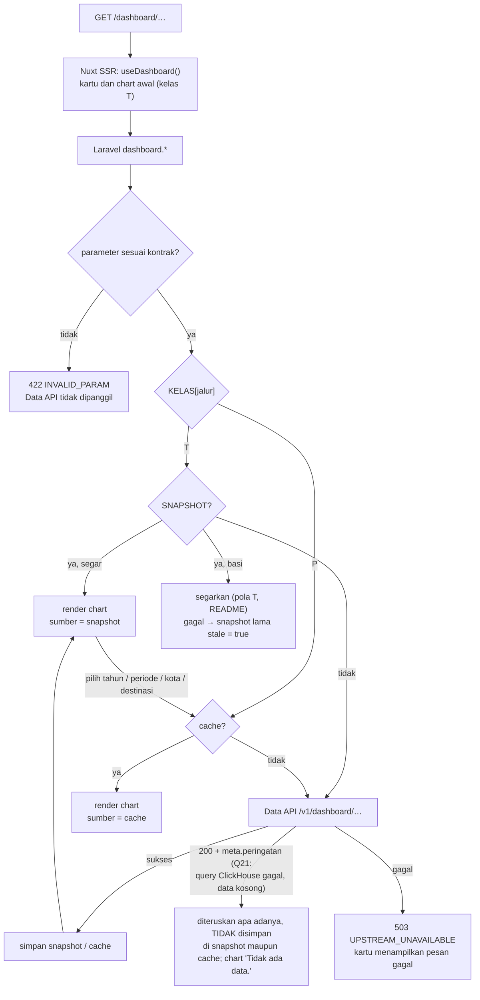

# Flowchart dashboard

Layer Nuxt `dashboard`, fitur Laravel `Features/Dashboard`. Pola baca umum, termasuk penyegaran snapshot basi dan jawaban berperingatan: [README.md](README.md).

Rute halaman: `/dashboard`, `/dashboard/wisman`, `/dashboard/wisnus`, `/dashboard/tenaga-kerja`,
`/dashboard/pdrb-ekraf`.

Semua rute `GET /api/v1/dashboard/<jalur>` diteruskan ke `GET /v1/dashboard/<jalur>` Data API dengan
klien biasa (10 s, ulang 2×). Kelas di rute sama dengan `DashboardService::KELAS`.

| Rute API (nama) | Jalur | Kelas | Parameter |
|---|---|---|---|
| `dashboard.ringkasan` | `ringkasan` | T | — |
| `dashboard.wisman.tahunan` | `wisman/tahunan` | T | — |
| `dashboard.wisman.bulanan` | `wisman/bulanan` | T | `periode` |
| `dashboard.wisman.kebangsaan` | `wisman/kebangsaan` | P | `tahun`, `periode`, `top` |
| `dashboard.wisman.pintu-masuk` | `wisman/pintu-masuk` | P | `tahun`, `periode` |
| `dashboard.lama-menginap.rata-rata` | `lama-menginap/rata-rata` | T | — |
| `dashboard.lama-menginap.per-kelas` | `lama-menginap/per-kelas` | P | `tamu`, `periode` |
| `dashboard.lama-menginap.seri` | `lama-menginap/seri` | T (varian `tamu=wisman`, `tamu=wisnus`) | `tamu` |
| `dashboard.wisnus.meta` | `wisnus/meta` | T | — |
| `dashboard.wisnus.tahunan` | `wisnus/tahunan` | P | `kota` |
| `dashboard.wisnus.per-kota` | `wisnus/per-kota` | P | `tahun` |
| `dashboard.wisnus.bulanan` | `wisnus/bulanan` | P | `kota` |
| `dashboard.wisnus.yoy` | `wisnus/yoy` | P | `kota` |
| `dashboard.destinasi.meta` | `destinasi/meta` | T (varian `jenis=wisnus`, `jenis=wisman`) | `jenis` |
| `dashboard.destinasi.ringkasan` | `destinasi/ringkasan` | P | `jenis`, `tahun`, `destinasi` |
| `dashboard.destinasi.per-destinasi` | `destinasi/per-destinasi` | P | `jenis`, `tahun` |
| `dashboard.destinasi.bulanan` | `destinasi/bulanan` | P | `jenis`, `destinasi` |
| `dashboard.tenaga-kerja.dki` | `tenaga-kerja/dki` | T | — |
| `dashboard.tenaga-kerja.subsektor` | `tenaga-kerja/subsektor` | P | `tahun` |
| `dashboard.tenaga-kerja.sertifikasi` | `tenaga-kerja/sertifikasi` | T | — |
| `dashboard.pdrb-ekraf.makro` | `pdrb-ekraf/makro` | T | — |
| `dashboard.pdrb-ekraf.subsektor.sebaran` | `pdrb-ekraf/subsektor/sebaran` | P | `periode` |
| `dashboard.pdrb-ekraf.subsektor.pertumbuhan` | `pdrb-ekraf/subsektor/pertumbuhan` | P | `periode` |

