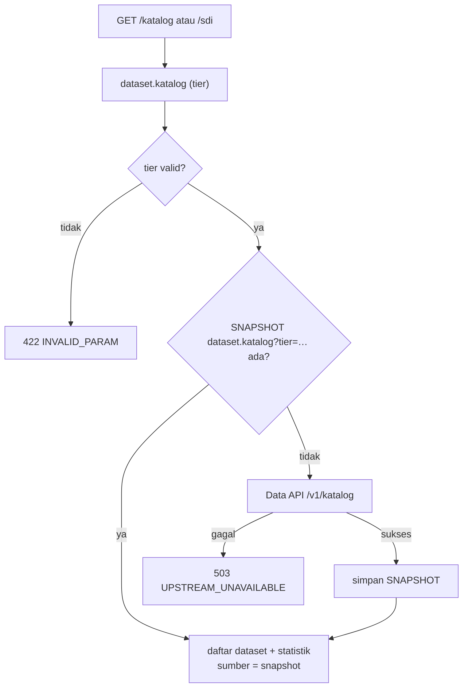
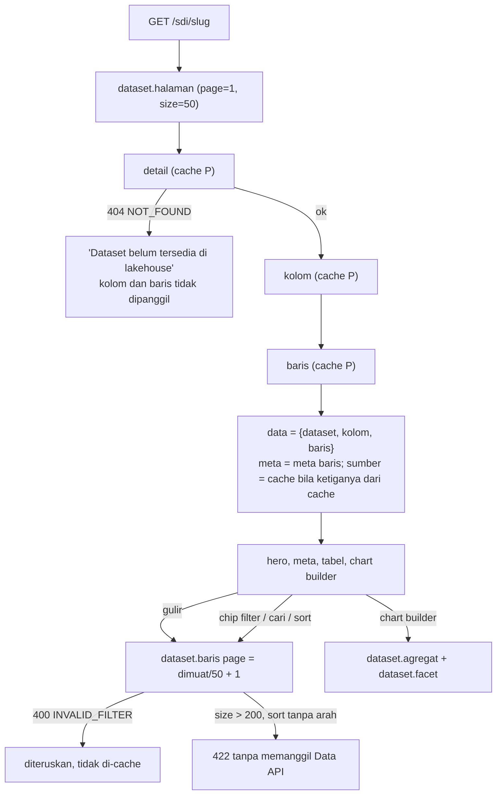
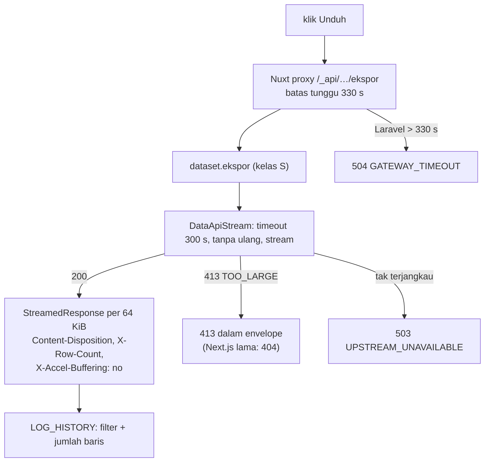

# Flowchart dataset

Layer Nuxt `dataset`, fitur Laravel `Features/Dataset`. Pola baca umum: [README.md](README.md).

Rute halaman: `/katalog`, `/sdi`, `/sdi/[slug]`.

| Rute API (nama) | Laravel `GET /api/v1/…` | Data API `GET /v1/…` | Kelas |
|---|---|---|---|
| `dataset.katalog` | `katalog?tier` | `katalog` | T (varian `tier=semua`, `tier=primer`) |
| `dataset.detail` | `dataset/{slug}` | `dataset/{slug}` | P |
| `dataset.kolom` | `dataset/{slug}/kolom` | `dataset/{slug}/kolom` | P |
| `dataset.facet` | `dataset/{slug}/facet` | `dataset/{slug}/facet` | P |
| `dataset.baris` | `dataset/{slug}/baris?page&size&sort&q&f[]` | `…/baris?…&f=…&f=…` | P |
| `dataset.agregat` | `dataset/{slug}/agregat?x&y&agg&q&f[]` | `…/agregat` | P |
| `dataset.halaman` | `dataset/{slug}/halaman` | gabungan detail + kolom + baris | P |
| `dataset.ekspor` | `dataset/{slug}/ekspor?format&q&f[]&sort` | `…/ekspor` | S |

## Katalog `/katalog` dan `/sdi`

`/katalog` meminta `tier=semua`, `/sdi` meminta `tier=primer`. Kedua varian diisi ulang tiap hari oleh
`portal:sinkron`. Cari, filter tier, dan lapisan dikerjakan di browser atas daftar yang sudah dimuat.

## Detail `/sdi/[slug]`

## Ekspor CSV/XLSX

Browser mengunduh langsung lewat proxy `/_api/dataset/{slug}/ekspor` (bukan JSON). Batas baris
diatur Data API (`EXPORT_MAX_ROWS`, bawaan 100.000).

