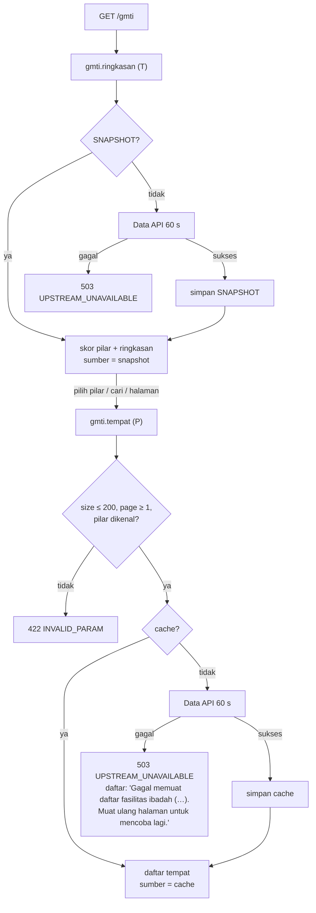

# Flowchart GMTI

Layer Nuxt `gmti`, fitur Laravel `Features/Gmti`. Pola baca umum, termasuk penyegaran snapshot basi dan jawaban berperingatan: [README.md](README.md).
Fitur yang sama melayani [spasial.md](spasial.md) dan [hotel-scraped.md](hotel-scraped.md).

Rute halaman: `/gmti`.

| Rute API (nama) | Laravel `GET /api/v1/…` | Data API | Kelas |
|---|---|---|---|
| `gmti.ringkasan` | `gmti/ringkasan` | `/v1/gmti/ringkasan` | T |
| `gmti.tempat` | `gmti/tempat?pilar&kota&jenis&q&page&size` | `/v1/gmti/tempat` | P |

Data API dipanggil dengan satu percobaan 60 s.

