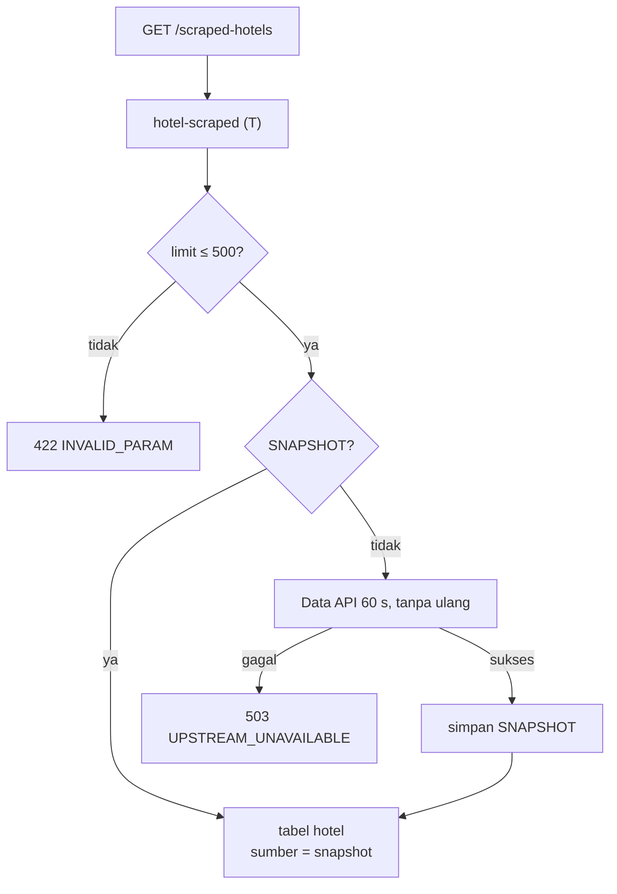

# Flowchart hotel scraped

Layer Nuxt `gmti` (halaman berbahasa Inggris, tiruan Next.js), fitur Laravel `Features/Gmti` dengan
modul log `hotel-scraped`. Pola baca umum: [README.md](README.md).

Rute halaman: `/scraped-hotels`.

| Rute API (nama) | Laravel `GET /api/v1/…` | Data API | Kelas |
|---|---|---|---|
| `hotel-scraped` | `hotel-scraped?limit` | `/v1/hotel-scraped` | T |

