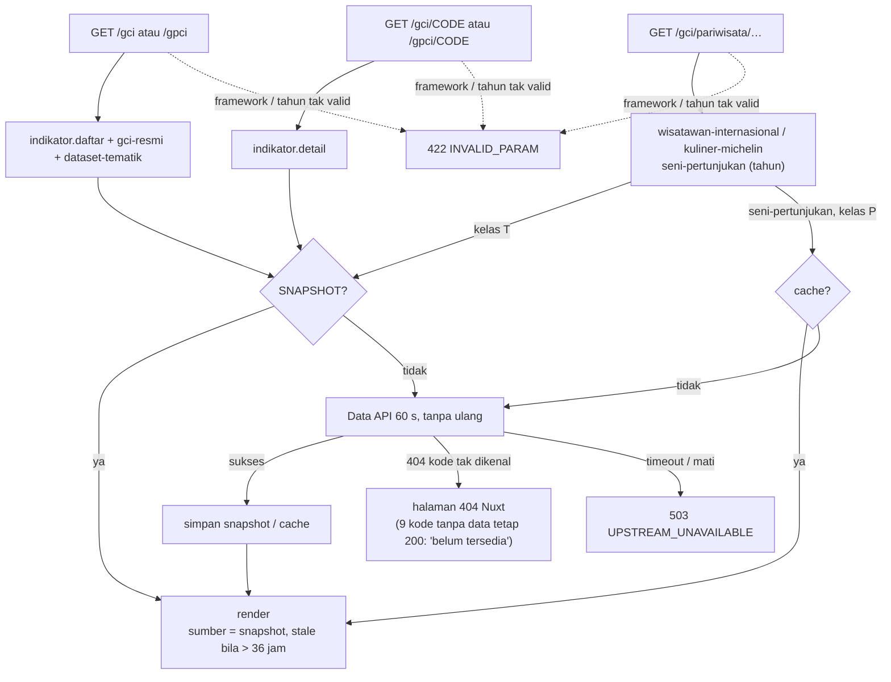

# Flowchart indikator

Layer Nuxt `indikator`, fitur Laravel `Features/Indikator`. Pola baca umum: [README.md](README.md).

Rute halaman: `/gci`, `/gpci`, `/gci/[code]`, `/gpci/[code]`, `/gci/pariwisata/wisatawan-internasional`,
`/gci/pariwisata/kuliner-michelin`, `/gci/pariwisata/seni-pertunjukan`.

Semua rute memanggil Data API dengan satu percobaan 60 s (`DATA_API_TIMEOUT_LAMBAT`): pemilihan
dataset indikator di Data API bisa belasan detik saat cache-nya dingin. Hasil kelas T disimpan di
snapshot, jadi pengunjung biasanya tidak menunggu.

| Rute API (nama) | Laravel `GET /api/v1/…` | Kelas |
|---|---|---|
| `indikator.daftar` | `indikator?framework` | T (varian `GCI`, `GPCI`) |
| `indikator.detail` | `indikator/{code}` | T (varian 28 kode) |
| `indikator.gci-resmi` | `gci/resmi` | T |
| `indikator.dataset-tematik` | `dataset-tematik?framework` | T (varian `GCI`, `GPCI`) |
| `indikator.wisatawan-internasional` | `pariwisata/wisatawan-internasional` | T |
| `indikator.kuliner-michelin` | `pariwisata/kuliner-michelin` | T |
| `indikator.seni-pertunjukan` | `pariwisata/seni-pertunjukan?tahun` | P |

Kode GCI dan GPCI saling diterima (`/gpci/CE1`, `/gci/CI-FV`) seperti di Next.js; tidak ada redirect.
