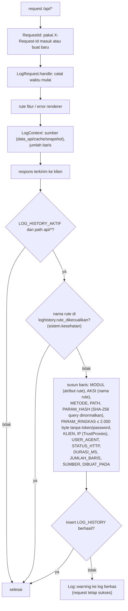
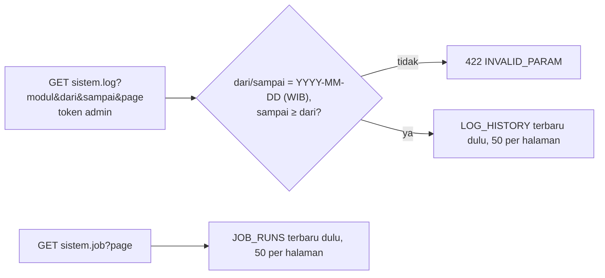
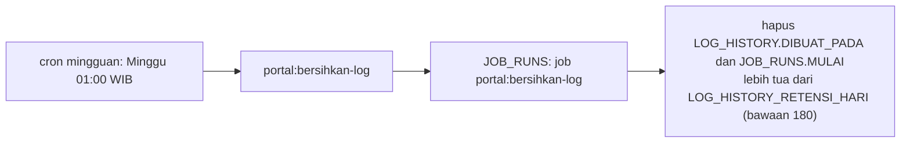

# Flowchart log history

SPEC §4.5. Seluruh perilaku log ada di `App\Shared\LogHistory`; job dicatat `App\Shared\Jobs\JobRunRecorder`.

## Satu baris per request

`LogRequest` dipasang global (bukan hanya grup `/api/v1`), jadi request ke alamat yang tidak ada
(404) dan metode yang ditolak (405) ikut tercatat. Penulisan terjadi di `terminate`, sesudah respons
terkirim: kegagalan menulis log tidak pernah menggagalkan request. Rute di
`loghistory.rute_dikecualikan` tidak dicatat; isinya `sistem.kesehatan`, karena dipanggil healthcheck
container tiap 30 detik dan hanya akan memenuhi tabel tanpa nilai audit.

Ekspor dataset selalu tercatat bersama filternya (query) dan jumlah baris dari header `X-Row-Count`.

## Membaca log (admin)

## Retensi

