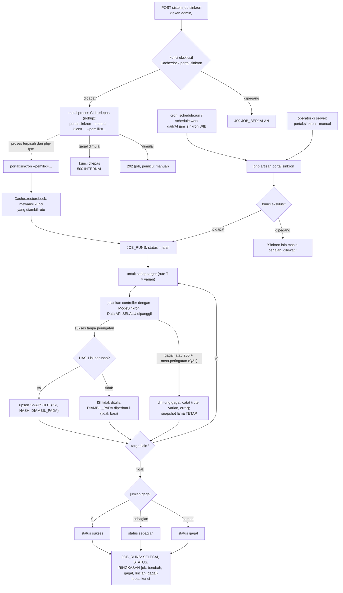
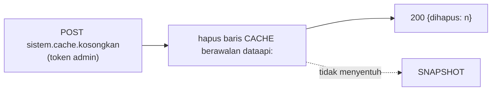

# Flowchart sinkron dan rute sistem

Fitur Laravel `Features/Sistem` (plan 16), SPEC §4.6. Tidak ada rute halaman: rute `sistem/*` ditolak
proxy Nuxt (404) dan hanya dipanggil operator dengan token `admin`, kecuali kesehatan yang publik.

| Rute API (nama) | Laravel | Ability | Isi |
|---|---|---|---|
| `sistem.kesehatan` | `GET /api/v1/sistem/kesehatan` | — | Oracle (`select 1 from dual`) + Data API `/v1/health` (3 s, tanpa ulang) + versi |
| `sistem.log` | `GET /api/v1/sistem/log?modul&dari&sampai&page` | admin | lihat [log-history.md](log-history.md) |
| `sistem.job` | `GET /api/v1/sistem/job?page` | admin | riwayat `JOB_RUNS`, 50 per halaman |
| `sistem.job.sinkron` | `POST /api/v1/sistem/job/sinkron` | admin | picu `portal:sinkron` manual |
| `sistem.cache.kosongkan` | `POST /api/v1/sistem/cache/kosongkan` | admin | hapus cache kelas P (SNAPSHOT tidak disentuh) |

## Job `portal:sinkron`

Jadwal: harian `PORTAL_JAM_SINKRON` (bawaan 11:00 WIB), setelah refresh Dagster 09:00 WIB
(`app/Console/Kernel.php`, `withoutOverlapping`). Target diturunkan dari rute: setiap rute GET
ber-`kelas` T × atribut `varian`-nya (tanpa varian = satu panggilan). Tiap target dijalankan lewat
controller rute itu sendiri dengan `ModeSinkron` aktif, jadi kunci snapshot sama persis dengan
request biasa.

Sinkron manual lewat API tidak dijalankan di worker php-fpm (yang bisa dibunuh
`request_terminate_timeout`), melainkan sebagai proses CLI terpisah. Rute mengambil kunci lebih dulu
lalu mewariskannya (`--pemilik`), sehingga pemicu kedua langsung dijawab 409 walau proses pertama
belum sempat mulai. Bila proses tidak bisa dimulai, kunci dilepas dan rute menjawab 500.

## Kosongkan cache

Untuk memperbarui snapshot kelas T setelah data lake berubah di luar jadwal, picu sinkron; cache
kelas P cukup dikosongkan (atau ditunggu habis TTL-nya, bawaan 15 menit).
