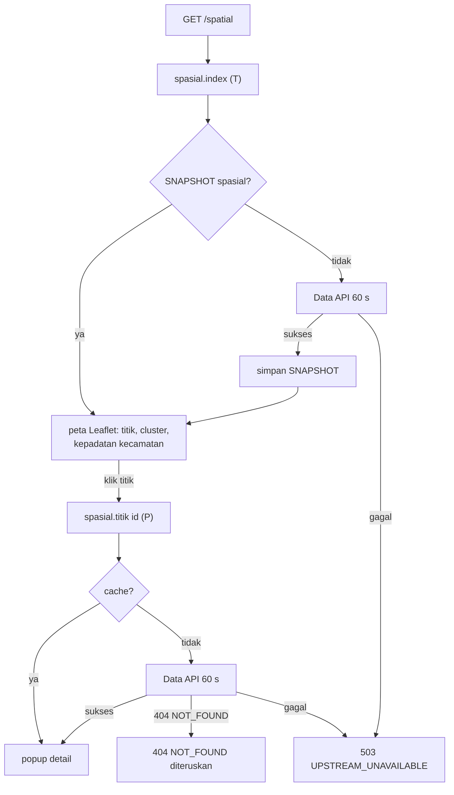

# Flowchart spasial

Layer Nuxt `gmti` (halaman peta), fitur Laravel `Features/Gmti` dengan modul log `spasial`. Pola baca
umum, termasuk penyegaran snapshot basi dan jawaban berperingatan: [README.md](README.md).

Rute halaman: `/spatial` (juga tujuan redirect `/atlas`, `/atlas/*/map`, `/gmti/map`).

| Rute API (nama) | Laravel `GET /api/v1/…` | Data API | Kelas |
|---|---|---|---|
| `spasial.index` | `spasial` | `/v1/spasial` | T |
| `spasial.titik` | `spasial/titik/{id}` | `/v1/spasial/titik/{id}` | P |

`/v1/spasial` menggabungkan ± 5.000 titik dan kepadatan per kecamatan (point-in-polygon) di Data
API; satu percobaan 60 s, hasilnya disimpan di snapshot.

